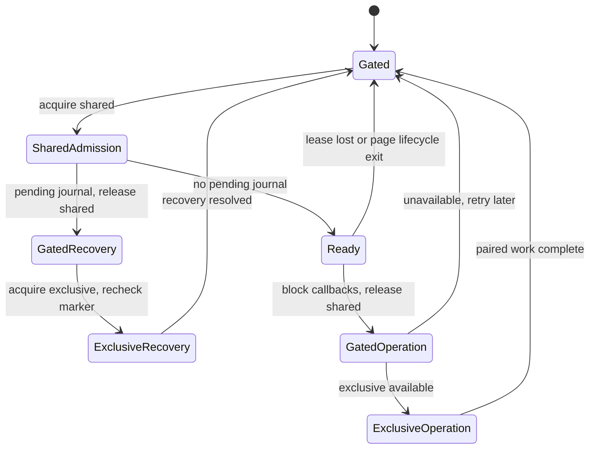
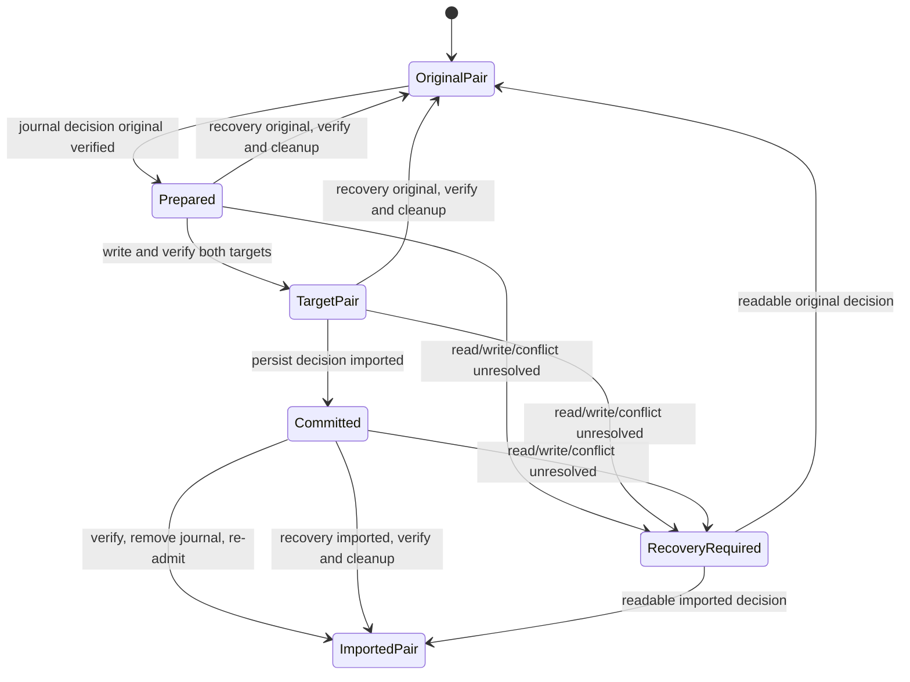

# Progress backup and restore

Status: selected for L1 implementation — backup/user flow, coordination, journal/recovery, validation/limits and browser acceptance criteria. L0-A design complete; application release verification pending L1. Date: 2026-10-12.

This decision record owns the current-contract evidence and selected backup format/user flow for [L0](../work/done/L0-local-contracts-plan.md). It selects a coordination protocol based on isolated feasibility probes; journal/recovery semantics are selected below; validation/limits are selected below; browser acceptance criteria are selected below. L0-A permits L1 implementation; it does not certify the finished feature. No runtime backup implementation exists.

## Scope and evidence method

Inspected tracked source and relevant repository documentation. Inventoried non-test storage writes and repository call sites with rg; verified callers against both session hooks and quiz screen callbacks. No real browser progress, private study history, personal storage export or live UI was inspected. All runtime behavior below is a source baseline, not a new guarantee.

Guidance reviewed: [architecture](../architecture.md), [testing](../testing.md), [regressions](../testing-regressions.md), [design system](../design-system.md) and [product](../product.md). Storage stays in persistence, domain rules stay independent of React, feature sessions own their storage use, and app composes cross-feature behavior. Shared presentation cannot import persistence.

## Boot, ownership and navigation

- [main.tsx](../../src/main.tsx), boot: renders the disabled-drawer loading shell, dynamically imports App, then mounts it under React StrictMode. No progress recovery/participation gate exists. Development content QA is a separate bootstrap branch.
- [App.tsx](../../src/app/App.tsx), module-level attemptRepository and LearnerApp: constructs one quiz repository without an immediate storage read, subscribes via useSyncExternalStore, creates the quiz session, and starts content loading separately in an effect.
- [useFlashcardSession.ts](../../src/features/flashcards/session/useFlashcardSession.ts), module-level flashcardProgressRepository: constructs a separate repository without an immediate storage read; the hook subscribes and reads it during rendering. Both instances need deliberate coordination in a future paired restore; they are not currently injected through one app-owned storage coordinator.
- [navigation.ts](../../src/app/navigation.ts), View/screenIdentity: composes quiz and flashcard views. Current quiz states include dashboard, subject, quiz, quiz-browse, quiz-review and results; flashcards include dashboard, subject and study. No backup/settings screen exists.
- [AppNavigationDrawer.tsx](../../src/app/components/AppNavigationDrawer.tsx) owns learner destination actions. App routes active-quiz exit and review exit through confirmations; flashcard navigation uses saveAndExit and must succeed before switching destinations. A backup utility will need a defined interaction with these existing contracts, but Step 1 selects no new UI.
- [useQuizLaunch.ts](../../src/features/quizzes/session/useQuizLaunch.ts) and the flashcard launch token guard defer study writes until content has loaded and prevent abandoned launches from committing. Future restore must account for delayed callbacks as well as visible editable screens.

## Storage keys, ports and required envelopes

[progressCodec.ts](../../src/persistence/progressCodec.ts) defines StoragePort with getItem and setItem only. There is no removeItem contract. No generic storage transaction abstraction exists.

Quiz storage key: meducation.progress.v2. Its schema-v2 envelope requires schemaVersion, revision, active, completed, completionCounts, lowestScores, latestScores, activity and completedIds. An absent current key yields emptyProgress: revision initial, empty completed array and empty maps. The quiz repository reads only this current key; retired v1 keys are ignored. Invalid current data is not replaced from an older key.

Flashcard storage key: meducation.flashcards.progress.v2. Its schema-v2 envelope requires schemaVersion, revision and checkpoints. completionCounts may be omitted in legacy v2 bytes and normalizes to an empty map without a write. dailyStats is optional and remains absent when not supplied. Missing current storage yields revision initial, empty checkpoints/counts, and no dailyStats. There is no migration/merge with quiz progress.

Storage revisions are optimistic edit tokens, not content revisions or export timestamps. Quiz missing-storage comparison uses null internally; flashcard missing-storage comparison uses the initial revision returned by its loader. Both successful commits generate a fresh crypto.randomUUID revision.

## Quiz fields and optional/default behavior

[types.ts](../../src/domain/types.ts) and progressCodec.ts own the quiz record contract.

- An Attempt requires id, quizId, subjectId, feedbackMode, startedAt, elapsedMs, celebrationProgress and responses. feedbackMode is immediate or exam.
- Optional fields are timerStartedAt, currentQuestionId, contentSignature, contentRevision and completedAt. Although the domain type marks contentSignature optional, decodeProgress requires a nonempty signature for each active-map record. contentRevision is optional diagnostic bank identity, not the required per-quiz signature.
- Responses require questionId, flagged, locked and timeMs; selectedChoiceId is optional. Immediate-mode selected answers must be locked under the current decoder. Blank responses have no choice, false flags/lock and timeMs zero in [quizEngine.ts](../../src/domain/quizEngine.ts).
- celebrationProgress requires correctStreak and awardedStreakMilestones. New quiz attempts start with zero streak, no awarded milestones and no responses. Valid milestone values are 3, 5, 10, 25 and 50.
- CompletedAttempt requires completedAt and score: correct, incorrect, unanswered, total, percentage and elapsedMs. saveCompleted removes contentSignature from the retained historical copy; optional contentRevision is kept. The just-completed in-memory results view still holds its complete attempt object.
- Durable latestScores entries hold percentage/completedAt; activity entries hold timestamp strings; completionCounts/lowestScores/completedIds are separate maps. completedIds includes completions beyond retained history.
- Attempts have no separate question-content fields, but active contentSignature is the exact serialized question IDs/stems/ordered choices/source and verified answers, so active storage does contain that text indirectly. saveCompleted deliberately strips this signature. Retained historical responses/scores therefore do not constitute a historical question snapshot.

Decoder limits are weaker than a file-import contract: extra object fields are accepted, timestamp strings are only checked for nonemptiness, numeric counts are not all safe-integer bounded, score sums/percentage consistency are not checked, response map keys need not match questionId, and duplicate completed IDs or active/completed overlap are not explicitly rejected. It does check active map-key/quizId agreement and retained completed-ID membership. Read validation is not a cryptographic authenticity guarantee; quiz writes do not revalidate the entire prospective state through decodeProgress before setItem.

## Flashcard fields and optional/default behavior

[flashcardStudy.ts](../../src/domain/flashcardStudy.ts), [flashcardProgressCodec.ts](../../src/persistence/flashcardProgressCodec.ts) and [flashcardDailyStats.ts](../../src/domain/flashcardDailyStats.ts) own this contract.

- A checkpoint requires deckId, currentCardId, contentSignature, updatedAt, openedCardIds and flaggedCardIds. There are no optional checkpoint fields. Helpers default both ID lists to empty and updatedAt to the current ISO timestamp when constructing a new checkpoint; decode requires explicit lists.
- Checkpoint deckId must agree with its map key, timestamp must round-trip to canonical ISO, and opened/flagged arrays must contain unique nonempty strings. Checkpoint/envelope unknown keys are rejected.
- completionCounts requires safe nonnegative integer values and a safe aggregate sum; it defaults to an empty map only when omitted. Removed/unknown deck keys can remain in stored state.
- Optional dailyStats contains firstDay/currentDay YYYY-MM-DD local-calendar strings and positive safe currentDayCount, trackedCompletions and highestDailyCount. firstDay cannot follow currentDay; currentDayCount <= highestDailyCount <= trackedCompletions; trackedCompletions cannot exceed total completion counts. No dailyStats object represents zero-day activity; absent history is valid.
- Daily completion uses browser-local date parts, not UTC day boundaries. Calendar comparisons use a UTC ordinal only to compare already-chosen calendar days. Clock rollback does not move the tracked current day backward. Dashboard averages use tracked completions over elapsed local-calendar days, not all-time completion counts divided by a retained event log.
- A checkpoint stores a SHA-256 signature, not card bodies. Resume checks current card existence, signature equality and opened/flagged membership against loaded cards. Missing/changed content requires explicit restart; empty decks do not start or complete.

The flashcard decoder is more restrictive than the quiz decoder, but lacks file-byte/depth/string/container caps and a recursive dangerous-property policy. New flashcard commits validate the prospective state before writing. These are distinct current behaviors, not proof either decoder is sufficient for arbitrary uploads.

## Write-path checklist: quiz

All seven existing non-test repository call sites are in useQuizSession.ts. start and changed-content restart share the beginQuiz call site.

- [x] Start: startQuiz -> beginQuiz -> saveActive. Creates stable UUID attempt, current first question, signatures/revision, started timer; enters quiz only after success.
- [x] Explicit changed-content restart: restartPendingResume -> beginQuiz -> saveActive. Replaces active quiz with a new attempt, using the saved feedback mode; cancels the pending prompt only after success.
- [x] Resume: resumeQuiz -> saveActive. Checks current signature, selects paused fully answered immediate mode or restarted timer, preserves current-question position, enters quiz only after success.
- [x] Answer/flag/navigation checkpoint: [QuizScreen.tsx](../../src/features/quizzes/screens/QuizScreen.tsx) callbacks -> checkpoint -> saveActive. Persists answer/flag/current-question state. Fully answered immediate feedback pauses the timer. No successful UI checkpoint transition follows a failed write.
- [x] Finish: finishQuiz -> saveCompleted. Pauses, calculates score against loaded content and stores completion before entering results.
- [x] Save and leave: leaveQuiz -> saveActive. Persists paused attempt and current question before committing the destination.
- [x] Abort: abortQuiz -> clearActive. Deletes only this quiz's active map entry before navigation; does not create a completion.
- [x] Browser pagehide: hook listener -> saveActive(pauseAttempt(view.attempt)), synchronously. Failure logs a safe message; no asynchronous unload save or retry is implemented.
- [x] Read-only Browse/Review and their navigation perform no progress writes. Results review is transient exam-mode review, not a retained-history browser.

## Write-path checklist: flashcards

All seven existing non-test repository call sites are in useFlashcardSession.ts.

- [x] Launch/start/resume: launchDeck after cards/signature/token checks -> saveCheckpoint. Preserves opened/flagged lists for valid resume; reveal starts hidden.
- [x] Confirm changed/missing-content restart: confirmRestart -> saveCheckpoint with first card and new signature; fresh lists by default.
- [x] Move/Previous/Next/navigator jump: moveTo -> saveCheckpoint. Persists new current card and existing lists before hiding/repositioning the answer view.
- [x] First reveal of an unopened card: toggleReveal -> saveCheckpoint marking opened ID. Hiding/revealing an already-opened card only changes ephemeral reveal state; it is not a new storage write.
- [x] Flag toggle: toggleFlag -> saveCheckpoint with changed flagged IDs while preserving current position/opened IDs.
- [x] Save and exit: saveAndExit -> saveCheckpoint; returns false on missing content/write failure so navigation stays in study.
- [x] Finish: finish -> completeDeck, only on last card of a nonempty deck with a checkpoint; then navigates after success.
- [x] clearCheckpoint exists on the repository but has no non-test runtime caller. It is still a potential write entry point for future guards.
- [x] There is no flashcard pagehide save listener. Position/opened/flagged writes occur during actions; revealed-face state is ephemeral and always resumes hidden.

## Repository semantics and retention

[localRepository.ts](../../src/persistence/localRepository.ts): reads cache a recursively frozen ProgressState. Corrupt/unavailable reads can yield an empty snapshot plus getStorageError; raw bytes are preserved. Missing storage yields a valid empty snapshot without error. Cached error state is not a valid successful export and should not be confused with missing storage. The normal quiz cached path does not automatically retry unavailable storage until invalidation/storage replacement.

[localFlashcardProgressRepository.ts](../../src/persistence/localFlashcardProgressRepository.ts): reads cache a frozen outer state, frozen checkpoint map/checkpoints/ID arrays and frozen completionCounts. The optional dailyStats object is not frozen by freezeProgress; do not describe this as recursively frozen. Corrupt reads return an empty-shaped error snapshot; unavailable reads may retain an existing cache and retry access on subsequent reads. Raw unreadable bytes are not overwritten.

Both repositories perform synchronous single-key read/revision-check/serialize/setItem/readback commits. They update their own cache/subscribers after success. Their storage handlers invalidate only the corresponding cache (or any-key clear event) and notify subscribers while retaining the original editing revision. A displayed cross-tab refresh therefore does not authorize a stale editor to overwrite newer state. There is no cross-key journal, Web Lock, participation token, restore method or startup recovery. Truly simultaneous read/check/write races remain possible.

Quiz saveCompleted keeps at most 200 newest retained records, stores durable completed IDs, increments per-quiz counts, preserves lowest/latest score summaries and activity, and removes only a matching active attempt ID. Repeating a known completed ID does not increment totals; a matching lingering active attempt can still be removed. Other active attempts for that quiz are not removed by completing a different ID. No TTL/cap is applied to durable ID/summary maps.

Flashcard completeDeck increments count, advances daily aggregates and removes checkpoint in one storage write. A repeated finish without a checkpoint is a no-op; this is checkpoint-presence deduplication, not durable per-session completion-ID deduplication. Counts/maps have no history-pruning policy.

## Timer/content identity evidence

[quizEngine.ts](../../src/domain/quizEngine.ts), elapsedTimeFor/pauseAttempt/resumeAttempt: elapsed time is accumulated elapsedMs plus nonnegative wall-clock time since timerStartedAt when present. pause clears the start timestamp; resume accounts for a present old start timestamp before beginning a new run. A stale persisted running timestamp can therefore count time outside observed study. Step 2/5 must specify portable backup behavior; this baseline does not change existing timers.

[contentSignature.ts](../../src/domain/contentSignature.ts) owns quiz signature calculation; active attempt resume compares it with loaded current content. Quiz signatures are serialized question content; flashcard signatures are bounded SHA-256 digests. These are different contracts, not interchangeable hashes. Keeping active quiz resume compatibility currently requires preserving the serialized signature; replacing it with a digest requires a separate explicit migration decision. Old/unknown content must not be re-scored merely to validate stored personal statistics.

## Future write paths (not implemented)

- [ ] Backup replacement: both state keys, fresh revisions and coherent subscriber refresh.
- [ ] Restore journal prepare/commit/cleanup and raw-byte rollback, including deletion of originally absent keys if the chosen protocol needs it.
- [ ] Startup recovery and any other journal replay; pending study launches and pagehide must be included in coordination.

These are future design inventory items only. Their behavior is selected in later L0 steps and implemented in L1.

## Step 1 self-review and audit

Audited the document against the source inventory and session callers. Corrected overbroad assumptions: two repository constructions do not read immediately but hook rendering does; flashcard freeze is not fully recursive; retained completed quiz signature is intentionally removed; flashcard completion has no durable session-ID set; flashcard pagehide is absent; clearCheckpoint has no current caller; active quiz signatures embed text whereas flashcard signatures are digests. The L1 draft promise that no question text enters a backup conflicts with preserving current active signatures; this is recorded for resolution in Step 2/5, not silently solved by dropping signatures. Preserved current-versus-proposed distinctions and did not select later-step defaults.

Verification: six targeted persistence/quiz-session/daily-stat suites passed (37 tests), followed by the actual .ts flashcard-session suite (12 tests). The initial filter used .tsx for that suite and matched nothing; the audit caught it and ran the correct file. Total: seven existing suites, 49 passing tests. Build/typecheck passed with the existing non-blocking Vite chunk-size advisory. Relative source/document links, source assertions for write-call counts and special cases, and git diff --check passed. No new runtime feature or feature-specific test was added.

Protected canonical files have the same SHA-256 values before and after this step: question bank 11b3fd084f4462c16805069883f53defd538a4d0bcd4d3537ab4c101bd7a3901; flashcard bank fa6c863dd11085311111f9715a4a5e291a5e9e6a28ac03e4e51a83d0c4443ac7. No personal browser data was accessed.

Step 1 is complete. Its evidence is retained above; the authorized Step 2 decisions and audit follow below.

## Step 2 decision — Backup format and replacement semantics

Selected for L1 implementation on 2026-10-12. This is a design contract, not an implemented feature. Export normalization and strict validation details will be finalized in Step 5 without silently changing these v1 fields.

### Envelope and payload fields

The v1 file is a JSON object with exactly five top-level fields:

- format: the literal string meducation-progress-backup, identifying the application/format without a device or user identifier.
- version: the integer 1, versioning the portable file independently of local storage.
- exportedAt: canonical UTC ISO timestamp, describing when the snapshot was produced. Uploaded timestamps are untrusted metadata, never authorization or proof of authenticity.
- quiz: a required quiz payload with schemaVersion 2.
- flashcards: a required flashcard payload with schemaVersion 2.

No top-level checksum, bank copy, browser fingerprint, filename-controlled storage key, arbitrary metadata or authentication field is included in v1. Format/version checks distinguish unsupported files; exact size/type/field-depth caps are Step 5 work.

Quiz payload allowlist: schemaVersion, active, completed, completionCounts, lowestScores, latestScores, activity and completedIds. All are required, with the current map/array shapes. The local envelope's revision is omitted. Preserve all durable counts, activity and scores rather than deriving them from retained completed history. completedIds retains pruned completions for duplicate protection.

An active attempt carries id, quizId, subjectId, feedbackMode, startedAt, elapsedMs, celebrationProgress, responses and required contentSignature; optional currentQuestionId and contentRevision remain optional. It carries neither timerStartedAt, completedAt nor score. These exclusions define a paused active attempt and avoid active/completed ambiguity.

A retained completed attempt carries id, quizId, subjectId, feedbackMode, startedAt, elapsedMs, celebrationProgress, responses, completedAt and score; optional currentQuestionId and contentRevision remain optional. It carries neither timerStartedAt nor contentSignature, matching the normal retained-history contract. Exact record validation, consistent scoring numbers and conversion behavior for decoder-permitted anomalous local records remain Step 5 work; do not silently drop malformed records.

Response fields: questionId, flagged, locked and timeMs, plus optional selectedChoiceId. Celebration fields: correctStreak and awardedStreakMilestones. Score fields: correct, incorrect, unanswered, total, percentage and elapsedMs. latestScores values contain percentage/completedAt. IDs and content references retain their existing values; none are reallocated on import.

Flashcards payload allowlist: schemaVersion, checkpoints and completionCounts are required; dailyStats is optional. Canonical export materializes the existing legacy completionCounts default to an empty map; v1 import requires the resulting explicit map. Each checkpoint carries deckId, currentCardId, contentSignature, updatedAt, openedCardIds and flaggedCardIds. dailyStats, if present, carries firstDay, currentDay, currentDayCount, trackedCompletions and highestDailyCount. Absent daily history stays absent, not a fabricated zero-valued history object.

Portable payloads omit runtime revisions. A restore generates fresh storage revisions while keeping quiz/attempt/deck/card IDs, checkpoint timestamps, personal results and content references stable. Do not change startedAt/completedAt to the import date or count imported completion events again.

### Empty example

This shape represents explicit replacement with empty progress. The timestamp is illustrative, not fixture evidence or user data:

```json
{
  "format": "meducation-progress-backup",
  "version": 1,
  "exportedAt": "2026-10-12T00:00:00.000Z",
  "quiz": {
    "schemaVersion": 2,
    "active": {},
    "completed": [],
    "completionCounts": {},
    "lowestScores": {},
    "latestScores": {},
    "activity": {},
    "completedIds": {}
  },
  "flashcards": {
    "schemaVersion": 2,
    "checkpoints": {},
    "completionCounts": {}
  }
}
```

A missing quiz/flashcards field is invalid, not shorthand for leaving that system unchanged. Explicit valid empty payloads are accepted, with a prominent empty-replacement warning before confirmation. Omitted optional dailyStats does not preserve current dailyStats: replacement removes it along with the rest of the old flashcard state.

### Embedded signature content and sharing

Preserve existing active quiz contentSignature strings exactly in v1; they embed ordered question text, choices and source/verified answers. This intentionally accepts that saved unfinished quizzes make a backup contain some quiz content. There is no separate question bank/rationale/media payload and no new content authoring channel. Flashcard signatures remain opaque SHA-256 digests; do not parse, render or execute either signature to validate progress.

This preserves active resume compatibility without a content-signature migration in L1. Backups therefore cannot honestly be described as text-free or as safe to publish. Proposed user copy: “Backups include your study progress, saved answers, and question content for unfinished quizzes. Share them only if you intend to share that data.” Structural validation never turns an uploaded file into trusted medical content or trusted statistics.

All backed-up quiz timers are paused. Do not count elapsed time between export and restore. Step 5 defines exact normalization of existing running/stale timer fields and canonical numeric/date checks. Flashcard calendar-day strings retain their original calendar meaning without device-timezone rebucketing.

### Replace-only contract

The first release supports full paired replacement, not merging or partial quiz/flashcard import. Preview and validation are read-only. The user explicitly confirms overwriting both progress systems. Canceling file selection, an invalid file, canceling preview or dismissing before commit leaves stored progress unchanged.

Preview captures an immutable candidate and the current target baseline. A later progress change invalidates confirmation; re-preview rather than overwriting newly changed state. The exact baseline/coordination/recovery protocol is Step 3/4 work. Offer a current valid backup download before confirmation; it is optional and does not imply the browser has durably saved a second copy. If existing progress is corrupt, normal export cannot claim to be a valid backup; repair/raw recovery requirements are Step 4 work.

No imported completion is replayed through saveCompleted or completeDeck. Preserve historical scores without re-scoring against current answers. Unknown/removed content IDs remain in history, durable maps and saved sessions. Resume checks current content later using existing explicit restart flows. No signatures are used to populate the question bank or render medical explanations.

## Step 2 decision — User flow and state transitions

### Entry and current-screen behavior

Progress backup is an app-owned utility action in the existing learner drawer. Its dialog keeps the current Quizzes/Flashcards section identity; it does not create a new study destination or a general settings framework. Shared UI receives data/actions and never accesses localStorage directly.

- From either dashboard or subject screen: open the dialog without changing the study destination. Cancel/invalidate delayed quiz and flashcard launches first so a pending promise cannot begin study underneath it. Catalog loading can remain independent.
- From an active quiz or flashcard study: disable the utility action, with readable accessible guidance “Save and leave your study session before opening progress backup.” Do not implicitly save, abort, finish or pause the current session. Disabled controls need a wrapper/description that works for keyboard and touch users, not hover-only tooltip text.
- From quiz-review: first use the existing Leave Review confirmation. Cancel preserves review and does not open the utility. Confirm leaves review to the Quizzes dashboard and opens the backup dialog; no replacement occurs yet. This preserves the established warning about losing transient review access and avoids dismissing review implicitly during a later write.
- From results or Browse Answers: allow the dialog over the current read-only screen. Cancel preserves that screen. Successful replacement resets both feature sessions/pending prompts and returns to the Quizzes dashboard, avoiding stale results/browse/hidden study state.
- While another modal or the recovery gate owns the interface: do not open a competing backup dialog. Session callbacks and launch tokens must be reset/invalidated before successful restore returns to normal study. Step 3/4 determines the exact orchestration.

Backup access, parsing, export and replacement do not depend on a successful content request. The existing shell/drawer must keep the utility available when catalogs are loading or failed. Existing unrelated content requests may continue; no backup operation requires or sends a backup to an API. No local progress data is sent for telemetry.

### States

- idle: show Download backup and Choose backup file. Dialog can close. A storage error disables valid export and explains why; supported restore capability is evaluated under Step 6.
- reading: show “Reading backup…” and a polite progress announcement. Disable duplicate selection/export actions. Cancel/dismiss invalidates the file-read generation; late completion cannot reopen a preview or mutate storage.
- invalid: show a safe reason and Choose another file. Progress remains untouched; no raw uploaded value/HTML/error stack is rendered.
- preview: show backup date, retained completed quiz attempts, saved quizzes, total recorded quiz completions, saved flashcard decks and total recorded deck completions. Label retained history separately from durable totals. Preview both incoming and current totals where current data is readable, plus an empty-replacement warning if appropriate. Offer Download current backup, Cancel and Restore backup.
- committing: after explicit Restore backup, block study and duplicate actions, reject stale preview, and run the selected safety protocol. Do not permit dialog close/Escape/backdrop dismissal to abandon an in-flight write. Browser termination remains a recovery case, not a prevented event. Announce “Restoring progress…”.
- success: only after the chosen pair is coherent and ready, clear preview memory, reset both ephemeral session states and return to the Quizzes dashboard with “Progress restored.” Study timestamps/counts are not rewritten as new activity. If recovery is still pending, do not claim success.
- recoverable failure: if the original pair is restored/untouched and normal use is safe, explain the error and allow retry, another file or cancel. A stale preview goes back through validation/preview. A potential other-tab conflict has retry guidance, but Step 3 selects exact lock/tab messages.
- recovery-required: if a mixed/unresolved pair cannot safely return to normal use, show a dedicated blocking recovery view; neither new study nor an empty-success fallback is allowed. Step 4 selects supported recovery actions and persisted markers. Keep original/journal bytes instead of silently clearing them.

No dialog cancellation path before committing writes progress. Entering/exiting the review confirmation changes ephemeral navigation only. Successful download is not completion of a restore; file-date/count summaries are descriptive and untrusted.

### Proposed user-facing copy

Title: “Progress backup”. Intro: “Your progress is saved in this browser. Download a backup to keep a copy or move it to another browser.”

Actions: “Download backup”, “Choose backup file”, “Download current backup”, “Cancel”, “Restore backup”.

Replacement warning: “Restoring replaces all quiz and flashcard progress in this browser. It does not merge with your current progress.”

Empty warning: “This backup contains no saved progress. Restoring it will clear your current quiz and flashcard progress.” Use this only when both payloads are empty; show system-specific empty warnings when only one is empty. Absent dailyStats additionally means no imported daily-history aggregate.

Invalid-file example: “This file is not a supported progress backup. Your current progress has not changed.” More specific safe size/version/validation messages are finalized in Step 5/6.

Preview/retry conflict: “Your progress changed while this preview was open. Review the backup again before restoring.”

Error messages must reflect actual storage state: “Your current progress has not changed” is valid only before mutation or after verified rollback. A recovery-required error must not use that assurance.

## Step 2 self-review and audit

Reviewed the selected fields against ProgressState, Attempt/CompletedAttempt, FlashcardProgressState, FlashcardCheckpoint and FlashcardDailyStats. Verified that removing only runtime revisions does not remove contentRevision; absent dailyStats and explicit required maps are distinct; retained scores/durable totals are not recomputed. The v1 paused record shape excludes timerStartedAt while preserving signature-based resume; exact normalization remains Step 5 work.

Audited flow against App navigation and LeaveReviewDialog. Corrected the earlier ambiguous “close review after success” plan: review confirmation precedes opening the utility, while actual progress replacement still requires its own preview confirmation. Delayed launches must be canceled even on a currently non-editable subject view. Disabled-entry guidance must be accessible beyond hover. Error copy distinguishes safe rollback from recovery-required state.

Step 2 chooses no Web Lock mechanism, journal implementation, byte limits, browser version or database/auth provider. Those remain unchecked in the plan. Verification: the illustrative JSON parses; source-interface field comparison confirms both payload allowlists exclude only their envelope revisions; record fields were checked against current domain definitions. Relative links and git diff --check passed. Build/typecheck passed with the existing non-blocking chunk-size advisory. Canonical hashes match Step 1 and no runtime code changed. Baseline runtime suites were not repeated for this documentation-only step; Step 1's 49 passing tests remain historical evidence, not tests of this future feature. Stop before Step 3 until the user continues.

## Step 3 decision — Coordination protocol

Selected on 2026-10-12: use a same-origin Web Lock named meducation.progress.coordination.v1. Each cooperating initialized learner document holds a shared participation lease while it can read/write progress. Paired backup capture, replacement and journal recovery require an exclusive lease. The protocol protects these paired operations from cooperating study tabs; it does not serialize ordinary shared-participant writes against one another or fix the existing simultaneous optimistic-write race.

This is a design/prototype decision for L1, not a production implementation or an unconditional browser support claim. Step 6 and L1 integration retain their release gates, including Firefox and actual back/forward-cache restoration evidence.

### Why this choice

The synthetic probe demonstrates shared-tab admission and exclusive paired work without converting every save/checkpoint/pagehide into an asynchronous domain API. Ordinary persistence remains synchronous after admission. The expected user tradeoff is that another open app tab can block backup capture or restore until closed. Export capture must also be exclusive to get a coherent pair; holding only a shared lease does not stop a different tab changing one state between reads.

Alternative asynchronous per-write locks would improve normal cross-tab serialization but require changing synchronous session contracts and resolving unreliable awaited saves during pagehide. A single authoritative combined progress key could simplify paired replacement but requires a new live storage migration and coordinated codec/subscription changes. Neither is justified by the observed feasibility of the narrower participation design. Do not introduce a distributed lock service or a fake localStorage compare-and-swap.

### Admission and release rules

1. Before any progress repository reads in rendering or any mutating callback, the app enters a progress-initialization gate and acquires shared participation. Constructors may remain side-effect-free, but hook subscriptions/reads cannot run through that gate. React StrictMode setup/cleanup must be idempotent and must not create multiple live leases for one document.
2. With the shared lease held and no pending journal, hydrate both repositories, then admit the learner. Every commit rechecks its valid local lease/admission state and journal status. Losing participation gates further reads/writes; error or unsupported cases must not masquerade as an empty successful snapshot.
3. To capture a backup or restore, block current-document study callbacks and cancel delayed launches, finish/reject current writes, gate its snapshot consumers, then release its own shared lease. Await callback completion before requesting exclusive access. Do not await exclusive access while holding this document's shared lease.
4. Request exclusive access with ifAvailable. Null means other participation may still exist; no paired state is read as a coherent export or changed as a restore. Rejoin shared admission and show retry/close-tabs guidance. Closing a tab does not imply its lock has disappeared immediately; a harmless transient refusal is acceptable. Do not spin or force acquisition in production. Probe tests use bounded retry only to observe eventual browser cleanup.
5. With an exclusive lease, capture the stable pair or run the later Step 4 journal protocol. Keep the lease across all verified paired-state operations and cleanup. The lock alone does not make localStorage writes crash-atomic; Step 4 remains necessary.
6. After exclusive callback completion, reacquire shared participation, recheck journal/state and refresh both snapshots before enabling study. Restore must discard stale editing/review/result state. Do not leave a stale callback able to re-save pre-restore state.
7. Shared or queued acquisition may wait behind a restoring/recovering document. Keep the gate visible, use an abortable bounded wait (initial implementation target five seconds) and offer explicit retry after timeout; never fall back to an uncoordinated write. Final browser messaging is Step 6 work.

Implementation ownership: browser lock/storage globals and an injectable participation adapter belong in persistence. App owns the initialization/recovery gate and cross-feature launch cancellation. Existing quiz/flashcard commits, clear methods and pagehide checkpoints must all honor the same admission guard. A UI-only lock around Restore is insufficient.

### Pending journal and simultaneous startup

When an initializing document acquires shared participation and finds a pending journal, it must stay gated and immediately release that shared claim. It then requests exclusive recovery with a bounded abortable request. Multiple booting documents each release before queuing. Under exclusive access, the selected owner re-reads the marker: recover only if still pending; later queued owners see that work is already complete and do not replay it. Rejoin shared admission only after the chosen state pair is usable.

There is one acquisition/retry path per boot attempt, not recurring polling. User-triggered retry after timeout is allowed. This ownership protocol was probed with a synthetic marker; actual journal contents, rollback and cleanup rules are Step 4 work.



### Lifecycle behavior and safety limits

Pagehide must checkpoint the quiz synchronously while its participation is still valid, then gate the page and release its shared lease. Do not introduce an awaited unload write. App integration must centralize or explicitly order this with the existing feature listener so teardown cannot release participation before the save. Flashcards retain their action checkpoints and do not gain an implicit completion/pagehide save.

Every pageshow revalidates admission. A persisted back/forward-cache return must discard stale editable state and re-enter initialization; a controlled full reload before exposing study is the preferred simplest integration path. A page hidden or frozen without pagehide may retain participation and safely block an exclusive operation; do not expire or steal its lease because it appears inactive. A browser crash releases ownership; another tab may recover a remaining journal only under exclusivity. Lock loss/rejection invalidates local admission even if an old JavaScript promise remains alive.

Legacy/nonparticipating same-origin scripts are not fenced by Web Locks. The probe demonstrates they can write during an exclusive operation. Restore copy must tell users to close all other app tabs, including old builds. Do not claim security against malicious same-origin JavaScript or against another browser's independent localStorage. Unsupported feature/capability behavior is finalized in Step 6; a feature name alone is not a successful participation token.

The application never uses steal. The adversarial probe may use it only to force revocation and verify that the participant fails closed. Lock-manager query is diagnostic, not authority to ignore a null exclusive result or replace actual acquisition.

### Reproducible feasibility evidence

Retained probe: [runner](../../scripts/testing/probe-progress-coordination.mjs) and [synthetic fixture](../../tests/fixtures/progress-coordination/probe.html). Successful command: node scripts/testing/probe-progress-coordination.mjs chromium webkit. A loopback server uses an ephemeral port and newly created Playwright contexts; it never visits the real learner origin or reads personal browser storage. Its only keys are synthetic probe keys. The machine report is written under /private/tmp and copied to the [Step 3 evidence snapshot](../work/done/L0-step3-coordination-evidence.json).

Probes cover two shared documents, rejected exclusivity with safe rejoin, eventual exclusivity after other-document closure, new-reader gating, consistent paired capture, simultaneous boot recovery ownership, lost local permission, adversarial lock revocation, simulated unsupported state, synchronous pagehide checkpoint/reload/back navigation, synthetic persisted lifecycle and a legacy-script bypass demonstration. Chromium additionally covers renderer freezing and shared/exclusive owner crashes. Actual observed counts/versions are recorded in the evidence snapshot.

Coverage limits: no actual BFCache restoration was observed in either automated engine even with Chromium's disabling flag removed; the persisted-event branch is synthetic evidence only. Firefox binaries installed but repeatedly failed before a page could open (“Could not find profile folder”), including a disposable explicit profile. That is a test-environment limitation, not evidence the protocol works or fails in Firefox. Real Firefox and real persisted-cache integration remain required before claiming those browser guarantees. Headless WebKit is not manual iOS Safari verification. The crash probe does not implement a real journal or simulate power loss at every storage syscall.

### Step 3 self-review and audit

The audit found and corrected an immediate-release assumption: ifAvailable may transiently reject just after a tab closes. The runner now tests eventual cleanup within a bounded interval while production remains single-attempt/user retry. A locks.query snapshot must not be treated as ownership; actual acquisition still decides success. The fixture's synthetic “unsupported” and “lost” states are labelled as guard tests, and an adversarial actual revocation adds stronger evidence.

The probe initially ran with Chromium defaults that suppress back/forward caching; the final runner removes that flag and explicitly records whether actual cache restoration occurred. It did not occur, so no cache support claim is made. Firefox profile failures are preserved as a coverage gap instead of skipped tests being reported as passing. Source/global declarations are scoped to the retained probe, and no application repository, question content or learner UI is changed.

Verification: 21 final isolated probes passed (12 Chromium 153.0.8010.12, 9 WebKit 26.6). Lint and checked architecture boundaries, formatting, build/typecheck, relative-link/evidence assertions and git diff --check passed. The existing Vite chunk-size advisory remains. Canonical content hashes match Step 1. The report records Firefox/profile and actual-BFCache limitations; neither is counted as a passed test. No production progress coordination or real journal was implemented. Step 3 is complete as the scoped design/feasibility step; browser/application release acceptance remains pending Step 6/L1. Stop before Step 4 until the user continues.

## Step 4 decision — Restore journal and recovery

Selected 2026-10-13. Preserve the quiz and flashcard v2 keys and add exactly one journal key: meducation.progress.restore.v1. StoragePort will need removeItem in L1 to restore an originally absent key. An absent value is null in the journal, not the JSON text "null" stored in a progress key.

The journal is internal persistence data, never a user-upload format. The file importer cannot choose storage keys or submit a journal. All operations below require Step 3 exclusive participation, valid local admission ownership and blocked study/snapshot consumers. No application implementation exists yet.

### Journal schema and trust boundary

Top-level allowlist:

- format: exact literal meducation-progress-restore-journal.
- version: integer 1, independent of the backup and progress schema versions.
- operationId: fresh UUID identifying this restore. Preserve it throughout retry/recovery; it is not a security credential.
- decision: original or imported. original means prepared/uncommitted; imported means the commit decision has been stored. Both ASCII values are eight characters, so changing the decision does not enlarge the canonical journal string. This reduces quota pressure but does not guarantee a storage write succeeds.
- original: exactly quiz and flashcards, each the complete original raw storage string or null for an absent key. Preserve bytes even when JSON/progress validation fails; do not serialize a fallback empty snapshot.
- imported: exactly quiz and flashcards, each a complete canonical target v2 storage string including newly generated independent storage revisions. Both must pass strict target-state validation before journal preparation.

No timestamps, arbitrary key names, functions, browser identifiers, variable phase history or backup contents beyond the complete state pair are needed. Keys are fixed application constants outside the stored record. Targets keep the original imported IDs/counts/scores and paused timers; recovery reuses the exact target strings and revisions rather than re-importing/recounting.

Check raw journal size before JSON parsing, then exact format/version/types/allowlists, safe operation ID and bounded raw string sizes. Validate imported nested states as application data. Original raw strings are opaque rollback data: syntax-invalid originals are permitted within bounds, and never executed/rendered. Step 5 must set total journal and original/target limits separately from the portable-file cap, accounting for JSON string escaping and duplicated data. If an original pair exceeds the supported preservation budget, refuse restore before mutation; do not truncate it or delete it to fit.

A structurally valid journal cannot authenticate its own origin. Any malicious same-origin script can also edit localStorage directly. The protocol protects cooperative app operations and handles detected corruption/conflicts; it does not provide cryptographic tamper protection.

### Restore sequence under exclusivity

1. Cancel delayed study launches, gate all progress use, release this document's shared lease and obtain exclusive participation using Step 3. A blocked/unsupported acquisition writes nothing.
2. Read the journal first. If one exists, resolve the existing operation or enter recovery-required state before starting a new restore. Do not overwrite unresolved evidence with a new operation.
3. Read both current raw values and compare exactly with the preview baseline captured earlier. If reads fail or values changed, write nothing and require retry/re-preview. Raw readable-but-corrupt originals can be replaced only after the repair warning below.
4. Revalidate the immutable candidate and target state strings; allocate fresh revisions once for this operation. Capture complete original raw values/nulls. Build canonical prepared journal with decision original and enforce the combined preservation limits.
5. Persist prepared journal; read it back and require exact equality. Do not mutate either progress key until reservation is verified. A failed/uncertain reservation is handled by inspecting the actual journal, not by assuming the original pair has been lost.
6. Write the quiz target and verify exact raw equality; write the flashcard target and verify exact raw equality. Skip a write if it already equals its selected value. Both targets must be verified while the journal still selects original.
7. Replace the journal with its canonical decision imported form; read back and verify. Persisted decision imported is the logical commit point, not the later success UI, cleanup or a function's return value. There is no second independent commit-marker key.
8. Under the same exclusive lease, recheck the selected target pair, remove the journal, and verify absence. Cleanup occurs only after the chosen pair is verified. Do not delete unresolved evidence merely to remove an error screen.
9. Invalidate/rehydrate both repository snapshots, reset ephemeral study/review/result state, release exclusive ownership and rejoin shared admission. Check absence/recovery state again before enabling progress use and reporting success. No count or completion command is replayed.

No network call, modal awaiting user input or normal study operation occurs within the mutating critical section. File reading/preview and user confirmation happen before exclusivity; storage operations are synchronous. New booting documents remain gated behind exclusivity and then check the journal before admission.

### Decision-driven recovery

Recovery first acquires exclusive ownership and reads/validates the entire journal. Re-read before acting because a previous owner may already have recovered it. With no journal, do not infer a restore from fallback repository state; hydrate existing storage normally and preserve any storage error.

With a valid journal, first inspect current progress raw values. Each key may match its recorded original or target, including null. If either has a third unexpected value, keep all values/journal and enter conflict/recovery-required rather than overwriting potentially newer external data. This detects some nonparticipant interference but cannot fence legacy/malicious writers; close-other-tabs guidance remains mandatory.

- decision original: restore both exact original raw values. Remove a key that was absent originally. Verify both before deleting the journal. Corrupt originals return as corrupt bytes, not repaired/empty data; the normal read error remains visible and valid-file repair can be retried afterward.
- decision imported: complete or retain both exact target raw values, including the stored new revisions. Verify both before deleting the journal. Never roll back merely because the previous operation failed to show success.
- unknown/unreadable/invalid decision or journal: write nothing automatically. Preserve all three raw values and block ordinary progress use until safe resolution. A malformed record must not provide arbitrary storage destinations or unvalidated replay strings.

Repeat recovery is idempotent. If the selected pair is already present, verification/cleanup does not alter totals. If cleanup already succeeded, another retry sees no journal and keeps the pair. Do not create new revisions or completion events during journal replay.

### Failure ledger and uncertainty

API failures do not by themselves identify whether the logical commit occurred. In particular, a committed-marker set may succeed before its verification read fails. On any exception after journal preparation, remain gated, re-read the actual journal under exclusive ownership, and recover according to its readable decision. If it cannot be read, release ownership only into the gated recovery state and offer retry. Do not use the last attempted code line or in-memory prepared object as authority for rollback.

Required cases for L1 fault injection:

1. Lock/baseline/journal inspection failure before reservation: no mutation; retry/re-preview, or existing-journal recovery gate.
2. Prepared-journal set failure: if absent afterward and originals verify, current state is unchanged; if prepared record exists, its original decision guides cleanup/rollback. If unreadable, do not assert unchanged state.
3. Prepared readback failure/mismatch: targets have not been changed by this operation. Keep the journal and inspect/recover; unexpected operation ID/content means conflict rather than overwrite.
4. First/second target set or readback failure: readable original decision selects rollback of both originals; an inaccessible journal keeps the gate. Do not admit a half-written pair.
5. Commit-marker set failure: readable original selects rollback; readable imported selects roll-forward. If an injected port writes then throws, actual persisted decision still governs. Unknown state is gated.
6. Commit-marker readback failure: imported may already be committed. Re-read or defer; never unconditionally roll back.
7. Rollback/roll-forward set, removeItem or readback failure: retain the journal and recovery gate. A later attempt repeats the same selected pair safely. Changing write order to reduce temporary size is allowed only if the final selected-pair invariant remains.
8. Journal cleanup failure/readback uncertainty: verify current journal and selected pair; if committed journal remains, retry cleanup. If removal succeeded and selected pair is intact, do not invent a rollback. If reads are unavailable, remain gated until verifiable.
9. Snapshot refresh/re-admission failure after journal removal: retained pair remains authoritative; no rollback. Show initialization/recovery error, retry hydration and reset stale session state before enabling writes.
10. Unexpected nonparticipant progress value, journal replacement/operation mismatch, or malformed journal: preserve evidence and block automatic replay. Never overwrite newer unknown values in the name of recovery.

Throwing before/after getItem, setItem and removeItem, tab termination between calls, and retry interruption are separate tests. A failed individual setItem does not provide a cross-key transaction; storage access/quota errors and cross-document events follow the [HTML Storage specification](https://html.spec.whatwg.org/multipage/webstorage.html#the-storage-interface). Readback can confirm the API-visible value, not a disk fsync guarantee. This contract targets API-visible failures and tab/renderer interruption; it cannot promise zero loss after device power failure, browser eviction, manual clearing or OS/storage corruption.

### Quota and corruption handling

A backup under the file-size cap can still exceed storage capacity: originals remain stored while the journal holds escaped originals and targets, and target writes may temporarily grow the pair. There is no reliable reservation from a free-space estimate. Attempt journal preparation before any target mutation; if it does not fit, refuse safely. Never delete unrelated app data, old progress or the journal to make room automatically. Even equal-length commit decisions can fail; the same decision-driven recovery rules apply.

For readable-but-corrupt originals, allow a validated replacement after an explicit warning: “Some saved progress could not be read. Restoring this backup will replace it.” Preserve exact corrupt bytes in the journal for rollback. Normal Download backup remains unavailable for corrupt data; do not call an empty fallback a valid export. This path must respect the original-pair preservation limit.

For invalid/inaccessible journal state, supported non-destructive actions are Retry/reload and Download recovery data when bytes are readable. A raw recovery download is a distinct format named meducation-progress-recovery-raw, containing only the fixed quiz, flashcards and journal raw strings/nulls plus version 1. It is not accepted by the ordinary backup importer. Generate a local file without rendering or logging raw values; make clear it can contain saved answers/content. Download success is not proof of off-device durability.

Do not offer an automatic discard-journal/reset button in L1. Guidance can explain restoring a known-good v1 backup in another browser while retaining this browser's raw recovery copy; otherwise the L1 runbook must describe diagnosing/repairing a copy before changing original storage. Destructive site-data clearing is outside automatic recovery and cannot be described as lossless. If raw reads fail, disable recovery download and give retry guidance. If originals were restored but remain corrupt, show that error rather than falsely reporting valid study data.

### State model and audit evidence



Retained design model: [probe-progress-restore.mjs](../../scripts/testing/probe-progress-restore.mjs). It uses synthetic in-memory strings and injected interruption before/after each storage operation, then repeats recovery. Present, absent and deliberately corrupt originals are exercised. This tests decision convergence and raw-byte preservation, not application validation, browser quota or physical durability. The machine report is [Step 4 evidence](../work/done/L0-step4-restore-evidence.json). Full schema/size enforcement and actual-browser/journal integration remain L1 tests.

### Step 4 self-review and audit

The audit corrected the earlier unconditional “before-marker error means rollback” language: a marker write can take effect before a later read/exception. Recovery now trusts only the readable persisted decision, with a gate for uncertainty. It also distinguishes absent keys from stored null text, preserves corrupt originals, detects unexpected external values, and reuses committed revisions during retries. Equal-length decision strings avoid an avoidable marker-size increase without promising quota availability. Marker cleanup and refresh failures cannot silently return mixed snapshots or reverse a committed import.

Step 4 selects the internal key/schema, transaction/recovery sequence and fail-closed actions. It does not set Step 5's exact byte/depth/record limits or claim a production restore implementation. Verification: 90 restore-interruption cases, 618 additional recovery-interruption/retry checks and 3 fail-closed cases passed in the retained model. Lint/architecture, formatting, build/typecheck, link/evidence assertions and git diff --check passed. Existing Vite chunk-size advisory remains; protected canonical hashes match Step 1. No real browser data, application persistence or actual restore UI was changed. Step 4 is complete as a design/audit step. Stop before Step 5 pending user continuation.

## Step 5 decision — Strict validation, limits and normalization

Selected 2026-10-13. This defines the supported v1 contract for L1; existing local-storage decoders remain unchanged in L0. Decoder-accepted local bytes are not automatically valid portable progress. Unsupported/anomalous local progress must produce an explicit export error, not silent record deletion, recalculation or data repair.

### Validation order and object semantics

1. Before File.text, require File.size <=4 MiB. MIME/extension are selection hints, not trust checks. After decoding, enforce UTF-8 size on the input text and canonical output separately. Whitespace counts against the input cap. An accepted file is not a guarantee that browser storage can hold its restore journal/targets.
2. Parse using JSON.parse once; no eval, HTML rendering, signature parsing or content fetch. Preview/restore use the same immutable parsed/canonical candidate. Standard JSON.parse last-member behavior applies to repeated JSON object member names; do not claim lexical duplicate-member detection. Duplicate attempt IDs and list values in the parsed arrays are independently rejected. Canonical exporter emits each object member once.
3. Walk the parsed tree iteratively with root depth zero. Count root, every container and every scalar value as a node; object keys are separately bounded by schema/ID rules. Reject any object property named __proto__, constructor or prototype at every depth. Reject depth/node limits before building application projections. Apply a generic array-length ceiling of 10,000 and own-object-member ceiling of 50,000 before/between traversal expansion, then narrower schema caps. Count scheduled children toward the 250,000-node budget before pushing them; do not materialize unbounded Object.entries/child arrays first.
4. Apply exact required/optional field allowlists from Step 2. Objects must be records, not arrays/null; arrays must have their declared types. Unknown fields, including uploaded runtime revisions or timerStartedAt, are errors. Do not recursively merge parsed values into live objects; construct fresh typed structures with safe own-property checks and safe map writes.
5. Apply per-field/container bounds and semantic invariants below. Keep dates/signatures/IDs as data only. Reject unsupported format/version/schema versions before deeper interpretation.
6. Canonicalize only selected legacy defaults/paused timer exclusions during live export, then run the same v1 validator used for file import. Successful export must pass that validator and size checks. No storage mutation is performed by normalization.

No lower-trust field influences storage key selection, content rendering, entitlement, or code execution. Safe validation messages use fixed categories/known field names, never arbitrary uploaded snippets or raw parser stacks. Uploaded dates and scores are descriptive personal data, not authenticated facts.

### Exact v1 safety ceilings

Binary units below use MiB=1,048,576 bytes and KiB=1,024 bytes. These are bounded-processing ceilings, not promises about browser quota. Export and import share them.

- Portable input text and canonical backup JSON: 4 MiB each.
- Parsed-tree maximum depth: 16, root depth 0. Maximum visited values/containers: 250,000.
- Every ID string and ID map key: <=128 UTF-8 bytes, nonempty, no leading/trailing whitespace or ASCII controls, and not one of the three dangerous property names. Preserve remaining characters exactly; do not demand membership in today's bank or a particular generated prefix/UUID shape for historical IDs.
- Opaque contentRevision: nonempty and <=256 UTF-8 bytes when present.
- Active quiz contentSignature: nonempty and <=512 KiB UTF-8, copied exactly. Do not parse or replace it with a hash.
- Flashcard contentSignature: nonempty and <=256 UTF-8 bytes. Current generated value is sha256- plus 64 lowercase hex digits (71 ASCII bytes), but bounded older/unknown opaque strings are retained for the existing resume/restart decision. No exact hash-prefix requirement is imposed on stored legacy checkpoints.
- Retained completed attempts: <=200, matching current retention. Active quizzes: <=64, with unique active attempt IDs.
- Responses per active/completed attempt: <=1,000.
- Entries in each quiz completionCounts/lowestScores/latestScores/activity map: <=2,048. Durable completedIds: <=50,000.
- Flashcard checkpoints: <=128. Flashcard completionCounts map: <=2,048. Each openedCardIds/flaggedCardIds list: <=10,000 unique IDs, independently bounded.
- Milestone list: <=5 unique values, from 3,5,10,25,50. No unconstrained user-visible text field is added to the backup format.

The file/node caps also apply when otherwise legal per-container limits combine. A valid runtime state may outgrow these ceilings because current durable maps are unbounded. Refuse a normal export/import clearly in that case, preserve all stored bytes, and offer the bounded raw recovery path where applicable. Do not prune completed IDs or change live retention as part of L1. Future larger-format/retention work needs a new explicit decision/version.

### Timestamps, enums and numbers

UTC timestamps exportedAt/startedAt/completedAt/updatedAt/latestScores.completedAt/activity values use exactly YYYY-MM-DDTHH:mm:ss.sssZ, four-digit year, finite parse and exact Date.toISOString round-trip. Noncanonical timezone offsets, invalid calendar dates and unparseable text are rejected. A valid timestamp may be before another record's start or after exportedAt because device clocks can move; do not rewrite it or impose a wall-clock “not in the future” rule. Normalization never changes these timestamps to the restore date.

feedbackMode is exactly immediate or exam. flagged/locked are booleans; completedIds values are exactly true. Counts/streaks/score correct/incorrect/unanswered/total are nonnegative safe integers. Aggregate summation checks safety on each addition. Time values elapsedMs/timeMs/score.elapsedMs are finite nonnegative numbers <=Number.MAX_SAFE_INTEGER; fractional milliseconds are allowed because the domain type is number, not an integer contract. Scores and summary percentages are integers 0–100 under the current rounded scoring rule.

### Quiz semantic invariants

- active map keys equal their quizId. Active IDs are unique and cannot be in durable completedIds, including pruned completions. Active records have contentSignature but no completedAt/score/running timer.
- Retained completed IDs are unique and each exists in completedIds. Completed records have completedAt/score but no running timer/signature. Their quiz IDs may be removed/unknown today.
- Each response key equals questionId. selectedChoiceId, when present, is a valid bounded ID. In immediate mode, a selected response must be locked; a flagged unanswered response remains valid. Do not verify a historical choice against today's choices.
- score.correct+incorrect+unanswered equals total using safe additions. percentage equals total ? Math.round(correct/total*100) : 0. score.elapsedMs equals the completed attempt's elapsedMs. Response map size <=total and the number of selected responses equals correct+incorrect. Never recompute which answer was correct from the current bank/signature.
- Sum of completionCounts equals the number of durable completedIds. Counts per quiz are >=the number of retained completions for that quiz, not equal to retained count. This follows current saveCompleted, which updates counts and IDs together without pruning either. A discrepancy is unsupported/inconsistent data, not an invitation to regenerate IDs/totals.
- Positive completion-count keys have lowest/latest score summaries; summary keys cannot claim a score for a zero/missing completion count. Lowest score cannot exceed a known retained score for that quiz. Latest score timestamp cannot be earlier than a retained completion. Do not require its percentage to match a particular retained record when timestamps tie or the relevant record has been pruned. Preserve history-array order and summary values after validation.
- Celebration streak is a safe nonnegative integer. Milestones are unique and no greater than the current streak. Do not recompute streak from retained history or today’s scoring; detailed immediate/exam behavior remains the existing domain logic.
- activity may include saved-only or removed quizzes; it is independent of completed-score timestamps. Do not require active-only quizzes to have score summaries or demand all activity keys exist in current content.

### Flashcard semantic invariants

Checkpoint map keys equal deckId. current/opened/flagged IDs and digest references retain exact valid values; do not require membership in currently loaded content during backup. Lists are unique but flags need not be opened cards. updatedAt is canonical UTC.

Completion counts and their sum are safe nonnegative integers; unknown deck keys stay recoverable. No completion-ID set exists for flashcards, so do not invent one or replay completions. dailyStats follows the current domain calendar validator: valid YYYY-MM-DD dates, firstDay<=currentDay, positive safe counts, currentDayCount<=highestDailyCount<=trackedCompletions, trackedCompletions<=all-time deck completions. Its absence is valid even with positive all-time counts. Do not manufacture old daily history or equate tracked totals to legacy all-time totals.

Preserve calendar-day strings across browser/timezone transfer. Future completions use the destination browser’s existing local-day logic, including clock rollback handling; this is not a timezone-history migration. Empty quiz/flashcard maps with no dailyStats are valid explicit empty progress.

### Live export normalization and version policy

Read error/corrupt fallback snapshots are never normal export inputs. Valid missing storage normalizes to current empty state. Source validation allows the live envelope revision, known optional runtime timer fields and a known historical contentSignature inherited from Attempt, but rejects other unknown fields instead of quietly discarding them. Legacy flashcard completionCounts absence alone normalizes to an empty map; dailyStats stays absent.

The dialog is unavailable during editable study. The same-tab quiz must use its current save-and-leave flow before opening. For a readable saved active record with a valid timerStartedAt, copy elapsedMs unchanged and omit timerStartedAt. Do not call pauseAttempt using today's clock on stale records. That would add unobserved wall-clock time. A malformed timer timestamp is an export error, not a reason to silently strip it. An active completedAt/score is inconsistent and rejected. Source-only historical signature/timer fields are validated before their selected omission from the paused completed projection.

This deliberately does not claim to recover unsaved timing since the last accumulated-time checkpoint. Proposed copy: “Quiz timers are paused in backups. Time since an unfinished quiz's last saved timer checkpoint is not added.” The original local record is not edited during export. Import never restarts timers; resume later invokes existing domain behavior on the paused restored attempt. Completed score/timing, signatures, response IDs, counts and flashcard dates otherwise remain unchanged.

Support only the selected backup format version 1 and nested schemaVersion 2. Raw v2 storage dumps, raw recovery files, missing payloads, retired quiz-v1 records, unknown future versions and unknown extra fields are rejected by the normal importer with zero writes. Future conversion functions require their own explicit version fixtures; do not guess or recursively merge “compatible-looking” data.

### Journal and raw recovery ceilings

Use Step 4's exact journal allowlists and fixed destinations; originals remain opaque strings/nulls and imported states must satisfy the above strict rules plus generated UUID storage revisions.

- Combined original raw pair: <=4 MiB UTF-8. A single original value cannot exceed that combined ceiling.
- Combined canonical target raw pair including generated revisions: <=4.25 MiB UTF-8. This modest overhead budget is separate from the 4 MiB portable file, not permission to accept a larger portable file.
- Fully encoded journal input/output: <=20 MiB UTF-8 before parsing or storing. Nested target JSON strings are separately byte/depth/node/schema bounded when parsed. Strings must not be treated as permission to evade inner validation.
- Raw recovery file canonical output: <=64 MiB UTF-8. It is an exact allowlisted format/version with raw strings/nulls, never normal-import data. If unreadable/oversized bytes cannot fit this output ceiling, fail visibly without truncation or mutation; a recovery download is not guaranteed for arbitrarily large corrupt storage.

Measure fully encoded lengths; journal escaping can grow data much more than a simple doubling. For example, raw NUL/control characters in corrupt originals become six-byte JSON escapes. A pair inside its individual limit can still exceed the encoded journal cap; refuse before mutation. Limits and equal-size decision markers are not storage reservation. Quota failures still follow Step 4 recovery. Do not try allocating a large padding key to “prove” free space or delete originals to make room.

### Synthetic sizing and audit evidence

Retained [probe-progress-backup-limits.mjs](../../scripts/testing/probe-progress-backup-limits.mjs) creates only synthetic progress and stem strings. [Machine evidence](../work/done/L0-step5-limits-evidence.json) records exact sizes/limits and selected invariant assertions; it is not an implemented importer.

Measured examples: empty 307 bytes; 20 retained attempts x30 responses 63,024 bytes; 200 x100 responses plus 1,500 durable IDs 1,958,386 bytes; 200 x100 plus 50,000 IDs 4,092,387 bytes (under the 4,194,304-byte file cap). A 200 x300-response history is 5,621,185 bytes and must fail the file cap. The other per-record/node ceilings still apply.

A synthetic 300-question saved quiz with 1,200-character stems has a 379,391-byte signature, within 512 KiB. At 600 questions it has a 758,891-byte signature: the file is still small enough, but the signature ceiling rejects it. This demonstrates why validation cannot check only total file size and why out-of-contract generated states must fail clearly without truncation.

The ordinary 200x100/1,500-ID pair yields a 4,582,181-byte journal before current progress/target storage overhead. Control-heavy corrupt originals demonstrate rejection even inside the raw-pair cap. These numbers are safety/cost observations, not successful browser quota tests; full application boundary/round-trip/quota tests remain L1.

### Step 5 self-review and audit

Checked semantic rules against current saveCompleted/deduplication, rounded quiz scoring, response behavior, legacy flashcard defaults and daily-stat validation. Avoided chronological/future-date restrictions that would reject clock-skew records, kept tracked flashcard history distinct from all-time counts, and retained opaque old content references. Corrected the potential misconception that flashcard signatures are bare 64-character hashes: the actual sha256- prefix makes them 71 characters. The chosen 256-byte ceiling preserves bounded older opaque references.

The traversal audit also caught that pushing a full oversized container before checking the node count defeats the memory bound; the model now checks breadth and scheduled-node budget incrementally. The sizing audit caught that corrupt raw control characters can escape sixfold, so separate encoded journal/raw recovery limits are enforced rather than estimating by doubling. File-level and per-signature limits catch different synthetic cases. Numeric/date/timer assertions verify selected invariants but do not substitute for L1's complete strict validator, round-trip or real-browser storage tests. No personal progress or canonical question text was used.

Step 5 selects exact processing limits, semantic requirements, normalization and version rejection behavior. Browser capability/accessibility acceptance remains Step 6. Verification: all seven synthetic sizing scenarios and selected boundary/date/score/timer/tree/journal assertions passed. Lint/architecture, formatting, build/typecheck, link/evidence/hash checks and git diff --check passed; the existing Vite chunk-size advisory remains. The audit corrected Node-global references in the standalone probe and the pre-expansion traversal bound. Canonical hashes match Step 1, and no production validator or real browser progress was changed. Stop before Step 6 pending user continuation.


## Step 6 — Capability, lifecycle and accessibility acceptance

### Capability admission and safe failure

Normal paired export requires usable secure-context Web Locks and readable progress storage; restore and journal recovery additionally require successful storage writes/readback. Property existence is insufficient: lock acquisition/rejection and storage access exceptions must feed the coordinator state. Acquire participation before reading progress; inspect the journal before exposing snapshots. Storage availability checks use a disposable namespaced probe key, clean it up where possible, never overwrite progress, and never claim that a tiny successful probe reserves quota for a restore. A later access/commit failure still uses the journal rules.

If coordination is unavailable, disable normal export and restore. **No repeated-snapshot export fallback is selected.** Without valid participation, do not enable persistent study mutations, including pagehide checkpoints. Preserve content browsing and other non-writing behavior where possible, retain all saved bytes, and show: “This browser cannot safely coordinate saved progress. Use an updated supported browser to study with saved progress or transfer a backup.” Do not silently switch the repositories to an empty or transient store. This is a deliberate restriction of unsupported-browser behavior to avoid a new nonparticipating writer. Already-open legacy scripts remain outside the guarantee and all other app tabs must still be closed before replacement.

A pending journal with unavailable coordination, unreadable storage, malformed journal or recovery conflict requires the recovery gate; it is never an ordinary empty state. If storage is blocked, do not infer that keys are absent. If storage remains readable but writes fail, saved progress may be inspected only after valid participation and a readable absent journal; study mutations remain blocked until admission succeeds. No quota/private-mode detection heuristic may erase data or mislabel it as zero progress. A read-only ordinary export is permitted after exclusive capture with a readable absent journal even if a storage write probe failed; export itself does not need storage writes. Recovery always needs its full write/readback capabilities.

A separate raw recovery download may read the fixed three keys when readable and within Step 5's ceiling. Without exclusivity it is a best-effort diagnostic capture: label it potentially inconsistent and never importable as progress. Re-read to reject observed changes, but do not claim that repeated reads exclude an unseen write. Failed reads must produce an error, never fabricated null values. Inaccessible download APIs/file selection disable only the corresponding action with useful guidance; no network upload or server fallback is selected.

### Support targets and evidence boundary

Release targets are maintained desktop Chrome/Edge (Chromium), Firefox, and Safari (WebKit), on HTTPS; loopback development is tested separately. Record browser/OS versions, origin, mode, test command, result and limitations with L1 evidence. Test the production learner bundle, not just an isolated protocol fixture. Add backup-specific Chromium/Firefox/WebKit projects or a separate config; the existing learner Playwright configuration and verify:full run Chromium only and do not satisfy this matrix automatically.

Step 3 established 21 isolated passes on Chromium 153.0.8010.12 and WebKit 26.6. Firefox 155 failed to launch because its profile could not be found; that is unavailable evidence, not an application failure or a pass. Actual BFCache restoration was not observed; synthetic persisted-pageshow handler coverage does not establish real navigation coverage. Headless WebKit does not establish iOS Safari behavior. Existing app focus/mobile/download tests cover reusable patterns, not this new utility.

Before feature completion, all automated cases below must pass on each target engine, or an explicit supported-scope revision must disable the unsupported feature safely and update product copy. Firefox is a required target; launch repair or independent real Firefox execution remains L1 work. Lifecycle acceptance requires either an observed real BFCache return with correct re-admission or evidence that the tested configuration takes a fresh-load path safely; log which path occurred and leave unobserved BFCache-return coverage explicit. Repeat real Safari/iOS navigation checks before launch. Actual iOS Safari and Android Chrome file/download checks and VoiceOver or NVDA checks are public-launch gates; automated accessibility assertions alone do not close them.

### Interaction and resource contract

Before committing, Escape/backdrop/Cancel close the utility and discard the preview without writes. While reading, closing invalidates the operation token so a late File.text result cannot reopen/update the dialog. File.text has no required abort facility. Once journal mutation begins, Escape/backdrop/duplicate actions cannot dismiss or start another operation; announce “Restoring progress. Please keep this tab open.” The journal handles actual tab termination. Never promise that the browser can be prevented from closing.

Focus enters a labelled dialog, remains in its focus trap, and returns to its invoking drawer control or another stable visible navigation control when the drawer has closed. After successful restore, focus goes to a meaningful Quizzes-dashboard heading/control. Error/preview changes must not move focus unexpectedly; status uses polite live announcements, blocking errors use an appropriate alert, and busy state is exposed without repeating announcements on every render. Disabled study-state actions must have discoverable save-and-leave guidance, including keyboard access to the explanation.

Use a standard local file input and Blob download, not a required File System Access API. Clear the input after each selection attempt so the same file can be selected again; a canceled picker leaves the existing valid preview unchanged. File extension/MIME are hints, never trust signals. The replacement preview uses text-only summaries and a clear irreversible-in-app replacement warning, including empty replacement and embedded question-content sharing copy.

At 390px width, large text and reduced motion, all actions, errors and preview counts remain visible/reachable with scrolling and no page-wide horizontal overflow. Text alternatives must communicate progress without relying on color or animation. Keep commit/recovery failures actionable: retry under the selected lease rules, preserve/download readable raw evidence, and show specific guidance rather than the general app-reload error screen.

Generate filenames from the app/date only; never uploaded names. Revoke Blob URLs after the download has had time to start, on replacement of a download, and on teardown; test delayed revocation in real target browsers rather than revoking synchronously before navigation. Clear parsed candidates/raw preview copies and invalidate pending work on close, successful replacement or teardown. A stale callback must not save, commit, announce success or repopulate a dismissed dialog. There are no backup telemetry, server requests or uploaded-content logs. Unrelated content requests may continue, so network assertions check that backup bytes/operations are never sent rather than insisting the whole app makes zero requests.

### L0-A exit and audit

The [acceptance checklist](../work/ongoing/L0-browser-acceptance.md) assigns explicit assertions, evidence and gates. Steps 1–6 select the protocol, schema, recovery behavior, bounds and acceptance criteria; L1 may now implement these contracts. No observed feasibility failure currently invalidates the selected protocol. Firefox launch, application integration, actual storage quota, BFCache and manual accessibility/mobile checks remain verification obligations, not completed feature claims.

Self-audit removed the weaker export fallback because it contradicted exclusive paired capture. It also tightened unsupported-browser study writes, distinguished unreadable storage from absent keys, allowed safely coordinated read-only export when writes fail, and made late file reads/download cleanup and post-restore focus explicit. Step 6 changes documentation only; production behavior and canonical content are unchanged.

Verification: build/typecheck, changed-document link checks, all 14 acceptance-case state assertions, canonical hash checks and git diff --check passed. Existing Vite chunk-size advisory remains. No new browser test run is claimed for this documentation-only step. Stop before L0 Step 7 pending user continuation.
