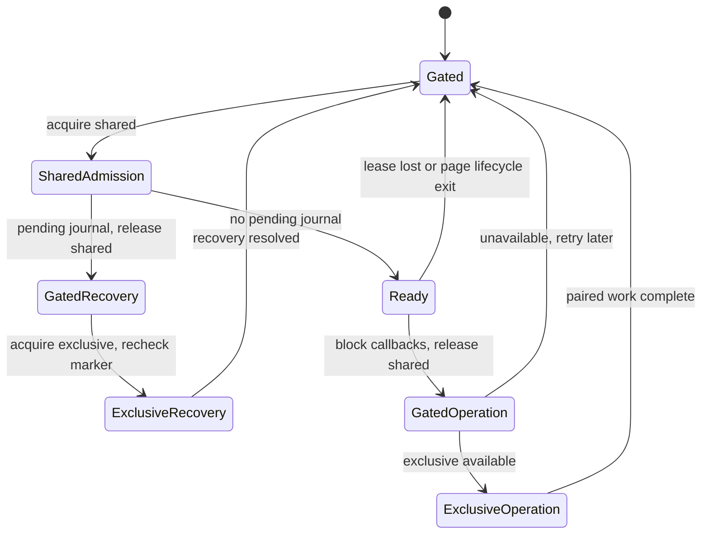

# Progress backup and restore

Status: partial decision — Step 2 backup format/user flow selected; Step 3 coordination selected for L1 integration; recovery, limits and release browser acceptance pending L0 steps 4–6. Date: 2026-10-12.

This decision record owns the current-contract evidence and selected backup format/user flow for [L0](../work/ongoing/L0-local-contracts-plan.md). It selects a coordination protocol based on isolated feasibility probes; restore journal, exact validation limits and final browser acceptance are still pending. No runtime implementation exists; L1 implements accepted contracts after the remaining L0-A gates pass.

## Scope and evidence method

Inspected tracked source and relevant repository documentation. Inventoried non-test storage writes and repository call sites with rg; verified callers against both session hooks and quiz screen callbacks. No real browser progress, private study history, personal storage export or live UI was inspected. All runtime behavior below is a source baseline, not a new guarantee.

Guidance reviewed: [architecture](../architecture.md), [testing](../testing.md), [regressions](../testing-regressions.md), [design system](../design-system.md) and [product](../product.md). Storage stays in persistence, domain rules stay independent of React, feature sessions own their storage use, and app composes cross-feature behavior. Shared presentation cannot import persistence.

## Boot, ownership and navigation

- [main.tsx](../../src/main.tsx), boot: renders the disabled-drawer loading shell, dynamically imports App, then mounts it under React StrictMode. No progress recovery/participation gate exists. Development content QA is a separate bootstrap branch.
- [App.tsx](../../src/app/App.tsx), module-level attemptRepository and LearnerApp: constructs one quiz repository without an immediate storage read, subscribes via useSyncExternalStore, creates the quiz session, and starts content loading separately in an effect.
- [useFlashcardSession.ts](../../src/features/flashcards/session/useFlashcardSession.ts), module-level flashcardProgressRepository: constructs a separate repository without an immediate storage read; the hook subscribes and reads it during rendering. Both instances need deliberate coordination in a future paired restore; they are not currently injected through one app-owned storage coordinator.
- [navigation.ts](../../src/app/navigation.ts), View/screenIdentity: composes quiz and flashcard views. Current quiz states include dashboard, subject, quiz, quiz-browse, quiz-review and results; flashcards include dashboard, subject and study. No backup/settings screen exists.
- [AppNavigationDrawer.tsx](../../src/app/components/AppNavigationDrawer.tsx) owns learner destination actions. App routes active-quiz exit and review exit through confirmations; flashcard navigation uses saveAndExit and must succeed before switching destinations. A backup utility will need a defined interaction with these existing contracts, but Step 1 selects no new UI.
- [useQuizLaunch.ts](../../src/features/quizzes/session/useQuizLaunch.ts) and the flashcard launch token guard defer study writes until content has loaded and prevent abandoned launches from committing. Future restore must account for delayed callbacks as well as visible editable screens.

## Storage keys, ports and required envelopes

[progressCodec.ts](../../src/persistence/progressCodec.ts) defines StoragePort with getItem and setItem only. There is no removeItem contract. No generic storage transaction abstraction exists.

Quiz storage key: meducation.progress.v2. Its schema-v2 envelope requires schemaVersion, revision, active, completed, completionCounts, lowestScores, latestScores, activity and completedIds. An absent current key yields emptyProgress: revision initial, empty completed array and empty maps. The quiz repository reads only this current key; retired v1 keys are ignored. Invalid current data is not replaced from an older key.

Flashcard storage key: meducation.flashcards.progress.v2. Its schema-v2 envelope requires schemaVersion, revision and checkpoints. completionCounts may be omitted in legacy v2 bytes and normalizes to an empty map without a write. dailyStats is optional and remains absent when not supplied. Missing current storage yields revision initial, empty checkpoints/counts, and no dailyStats. There is no migration/merge with quiz progress.

Storage revisions are optimistic edit tokens, not content revisions or export timestamps. Quiz missing-storage comparison uses null internally; flashcard missing-storage comparison uses the initial revision returned by its loader. Both successful commits generate a fresh crypto.randomUUID revision.

## Quiz fields and optional/default behavior

[types.ts](../../src/domain/types.ts) and progressCodec.ts own the quiz record contract.

- An Attempt requires id, quizId, subjectId, feedbackMode, startedAt, elapsedMs, celebrationProgress and responses. feedbackMode is immediate or exam.
- Optional fields are timerStartedAt, currentQuestionId, contentSignature, contentRevision and completedAt. Although the domain type marks contentSignature optional, decodeProgress requires a nonempty signature for each active-map record. contentRevision is optional diagnostic bank identity, not the required per-quiz signature.
- Responses require questionId, flagged, locked and timeMs; selectedChoiceId is optional. Immediate-mode selected answers must be locked under the current decoder. Blank responses have no choice, false flags/lock and timeMs zero in [quizEngine.ts](../../src/domain/quizEngine.ts).
- celebrationProgress requires correctStreak and awardedStreakMilestones. New quiz attempts start with zero streak, no awarded milestones and no responses. Valid milestone values are 3, 5, 10, 25 and 50.
- CompletedAttempt requires completedAt and score: correct, incorrect, unanswered, total, percentage and elapsedMs. saveCompleted removes contentSignature from the retained historical copy; optional contentRevision is kept. The just-completed in-memory results view still holds its complete attempt object.
- Durable latestScores entries hold percentage/completedAt; activity entries hold timestamp strings; completionCounts/lowestScores/completedIds are separate maps. completedIds includes completions beyond retained history.
- Attempts have no separate question-content fields, but active contentSignature is the exact serialized question IDs/stems/ordered choices/source and verified answers, so active storage does contain that text indirectly. saveCompleted deliberately strips this signature. Retained historical responses/scores therefore do not constitute a historical question snapshot.

Decoder limits are weaker than a file-import contract: extra object fields are accepted, timestamp strings are only checked for nonemptiness, numeric counts are not all safe-integer bounded, score sums/percentage consistency are not checked, response map keys need not match questionId, and duplicate completed IDs or active/completed overlap are not explicitly rejected. It does check active map-key/quizId agreement and retained completed-ID membership. Read validation is not a cryptographic authenticity guarantee; quiz writes do not revalidate the entire prospective state through decodeProgress before setItem.

## Flashcard fields and optional/default behavior

[flashcardStudy.ts](../../src/domain/flashcardStudy.ts), [flashcardProgressCodec.ts](../../src/persistence/flashcardProgressCodec.ts) and [flashcardDailyStats.ts](../../src/domain/flashcardDailyStats.ts) own this contract.

- A checkpoint requires deckId, currentCardId, contentSignature, updatedAt, openedCardIds and flaggedCardIds. There are no optional checkpoint fields. Helpers default both ID lists to empty and updatedAt to the current ISO timestamp when constructing a new checkpoint; decode requires explicit lists.
- Checkpoint deckId must agree with its map key, timestamp must round-trip to canonical ISO, and opened/flagged arrays must contain unique nonempty strings. Checkpoint/envelope unknown keys are rejected.
- completionCounts requires safe nonnegative integer values and a safe aggregate sum; it defaults to an empty map only when omitted. Removed/unknown deck keys can remain in stored state.
- Optional dailyStats contains firstDay/currentDay YYYY-MM-DD local-calendar strings and positive safe currentDayCount, trackedCompletions and highestDailyCount. firstDay cannot follow currentDay; currentDayCount <= highestDailyCount <= trackedCompletions; trackedCompletions cannot exceed total completion counts. No dailyStats object represents zero-day activity; absent history is valid.
- Daily completion uses browser-local date parts, not UTC day boundaries. Calendar comparisons use a UTC ordinal only to compare already-chosen calendar days. Clock rollback does not move the tracked current day backward. Dashboard averages use tracked completions over elapsed local-calendar days, not all-time completion counts divided by a retained event log.
- A checkpoint stores a SHA-256 signature, not card bodies. Resume checks current card existence, signature equality and opened/flagged membership against loaded cards. Missing/changed content requires explicit restart; empty decks do not start or complete.

The flashcard decoder is more restrictive than the quiz decoder, but lacks file-byte/depth/string/container caps and a recursive dangerous-property policy. New flashcard commits validate the prospective state before writing. These are distinct current behaviors, not proof either decoder is sufficient for arbitrary uploads.

## Write-path checklist: quiz

All seven existing non-test repository call sites are in useQuizSession.ts. start and changed-content restart share the beginQuiz call site.

- [x] Start: startQuiz -> beginQuiz -> saveActive. Creates stable UUID attempt, current first question, signatures/revision, started timer; enters quiz only after success.
- [x] Explicit changed-content restart: restartPendingResume -> beginQuiz -> saveActive. Replaces active quiz with a new attempt, using the saved feedback mode; cancels the pending prompt only after success.
- [x] Resume: resumeQuiz -> saveActive. Checks current signature, selects paused fully answered immediate mode or restarted timer, preserves current-question position, enters quiz only after success.
- [x] Answer/flag/navigation checkpoint: [QuizScreen.tsx](../../src/features/quizzes/screens/QuizScreen.tsx) callbacks -> checkpoint -> saveActive. Persists answer/flag/current-question state. Fully answered immediate feedback pauses the timer. No successful UI checkpoint transition follows a failed write.
- [x] Finish: finishQuiz -> saveCompleted. Pauses, calculates score against loaded content and stores completion before entering results.
- [x] Save and leave: leaveQuiz -> saveActive. Persists paused attempt and current question before committing the destination.
- [x] Abort: abortQuiz -> clearActive. Deletes only this quiz's active map entry before navigation; does not create a completion.
- [x] Browser pagehide: hook listener -> saveActive(pauseAttempt(view.attempt)), synchronously. Failure logs a safe message; no asynchronous unload save or retry is implemented.
- [x] Read-only Browse/Review and their navigation perform no progress writes. Results review is transient exam-mode review, not a retained-history browser.

## Write-path checklist: flashcards

All seven existing non-test repository call sites are in useFlashcardSession.ts.

- [x] Launch/start/resume: launchDeck after cards/signature/token checks -> saveCheckpoint. Preserves opened/flagged lists for valid resume; reveal starts hidden.
- [x] Confirm changed/missing-content restart: confirmRestart -> saveCheckpoint with first card and new signature; fresh lists by default.
- [x] Move/Previous/Next/navigator jump: moveTo -> saveCheckpoint. Persists new current card and existing lists before hiding/repositioning the answer view.
- [x] First reveal of an unopened card: toggleReveal -> saveCheckpoint marking opened ID. Hiding/revealing an already-opened card only changes ephemeral reveal state; it is not a new storage write.
- [x] Flag toggle: toggleFlag -> saveCheckpoint with changed flagged IDs while preserving current position/opened IDs.
- [x] Save and exit: saveAndExit -> saveCheckpoint; returns false on missing content/write failure so navigation stays in study.
- [x] Finish: finish -> completeDeck, only on last card of a nonempty deck with a checkpoint; then navigates after success.
- [x] clearCheckpoint exists on the repository but has no non-test runtime caller. It is still a potential write entry point for future guards.
- [x] There is no flashcard pagehide save listener. Position/opened/flagged writes occur during actions; revealed-face state is ephemeral and always resumes hidden.

## Repository semantics and retention

[localRepository.ts](../../src/persistence/localRepository.ts): reads cache a recursively frozen ProgressState. Corrupt/unavailable reads can yield an empty snapshot plus getStorageError; raw bytes are preserved. Missing storage yields a valid empty snapshot without error. Cached error state is not a valid successful export and should not be confused with missing storage. The normal quiz cached path does not automatically retry unavailable storage until invalidation/storage replacement.

[localFlashcardProgressRepository.ts](../../src/persistence/localFlashcardProgressRepository.ts): reads cache a frozen outer state, frozen checkpoint map/checkpoints/ID arrays and frozen completionCounts. The optional dailyStats object is not frozen by freezeProgress; do not describe this as recursively frozen. Corrupt reads return an empty-shaped error snapshot; unavailable reads may retain an existing cache and retry access on subsequent reads. Raw unreadable bytes are not overwritten.

Both repositories perform synchronous single-key read/revision-check/serialize/setItem/readback commits. They update their own cache/subscribers after success. Their storage handlers invalidate only the corresponding cache (or any-key clear event) and notify subscribers while retaining the original editing revision. A displayed cross-tab refresh therefore does not authorize a stale editor to overwrite newer state. There is no cross-key journal, Web Lock, participation token, restore method or startup recovery. Truly simultaneous read/check/write races remain possible.

Quiz saveCompleted keeps at most 200 newest retained records, stores durable completed IDs, increments per-quiz counts, preserves lowest/latest score summaries and activity, and removes only a matching active attempt ID. Repeating a known completed ID does not increment totals; a matching lingering active attempt can still be removed. Other active attempts for that quiz are not removed by completing a different ID. No TTL/cap is applied to durable ID/summary maps.

Flashcard completeDeck increments count, advances daily aggregates and removes checkpoint in one storage write. A repeated finish without a checkpoint is a no-op; this is checkpoint-presence deduplication, not durable per-session completion-ID deduplication. Counts/maps have no history-pruning policy.

## Timer/content identity evidence

[quizEngine.ts](../../src/domain/quizEngine.ts), elapsedTimeFor/pauseAttempt/resumeAttempt: elapsed time is accumulated elapsedMs plus nonnegative wall-clock time since timerStartedAt when present. pause clears the start timestamp; resume accounts for a present old start timestamp before beginning a new run. A stale persisted running timestamp can therefore count time outside observed study. Step 2/5 must specify portable backup behavior; this baseline does not change existing timers.

[contentSignature.ts](../../src/domain/contentSignature.ts) owns quiz signature calculation; active attempt resume compares it with loaded current content. Quiz signatures are serialized question content; flashcard signatures are bounded SHA-256 digests. These are different contracts, not interchangeable hashes. Keeping active quiz resume compatibility currently requires preserving the serialized signature; replacing it with a digest requires a separate explicit migration decision. Old/unknown content must not be re-scored merely to validate stored personal statistics.

## Future write paths (not implemented)

- [ ] Backup replacement: both state keys, fresh revisions and coherent subscriber refresh.
- [ ] Restore journal prepare/commit/cleanup and raw-byte rollback, including deletion of originally absent keys if the chosen protocol needs it.
- [ ] Startup recovery and any other journal replay; pending study launches and pagehide must be included in coordination.

These are future design inventory items only. Their behavior is selected in later L0 steps and implemented in L1.

## Step 1 self-review and audit

Audited the document against the source inventory and session callers. Corrected overbroad assumptions: two repository constructions do not read immediately but hook rendering does; flashcard freeze is not fully recursive; retained completed quiz signature is intentionally removed; flashcard completion has no durable session-ID set; flashcard pagehide is absent; clearCheckpoint has no current caller; active quiz signatures embed text whereas flashcard signatures are digests. The L1 draft promise that no question text enters a backup conflicts with preserving current active signatures; this is recorded for resolution in Step 2/5, not silently solved by dropping signatures. Preserved current-versus-proposed distinctions and did not select later-step defaults.

Verification: six targeted persistence/quiz-session/daily-stat suites passed (37 tests), followed by the actual .ts flashcard-session suite (12 tests). The initial filter used .tsx for that suite and matched nothing; the audit caught it and ran the correct file. Total: seven existing suites, 49 passing tests. Build/typecheck passed with the existing non-blocking Vite chunk-size advisory. Relative source/document links, source assertions for write-call counts and special cases, and git diff --check passed. No new runtime feature or feature-specific test was added.

Protected canonical files have the same SHA-256 values before and after this step: question bank 11b3fd084f4462c16805069883f53defd538a4d0bcd4d3537ab4c101bd7a3901; flashcard bank fa6c863dd11085311111f9715a4a5e291a5e9e6a28ac03e4e51a83d0c4443ac7. No personal browser data was accessed.

Step 1 is complete. Its evidence is retained above; the authorized Step 2 decisions and audit follow below.

## Step 2 decision — Backup format and replacement semantics

Selected for L1 implementation on 2026-10-12. This is a design contract, not an implemented feature. Export normalization and strict validation details will be finalized in Step 5 without silently changing these v1 fields.

### Envelope and payload fields

The v1 file is a JSON object with exactly five top-level fields:

- format: the literal string meducation-progress-backup, identifying the application/format without a device or user identifier.
- version: the integer 1, versioning the portable file independently of local storage.
- exportedAt: canonical UTC ISO timestamp, describing when the snapshot was produced. Uploaded timestamps are untrusted metadata, never authorization or proof of authenticity.
- quiz: a required quiz payload with schemaVersion 2.
- flashcards: a required flashcard payload with schemaVersion 2.

No top-level checksum, bank copy, browser fingerprint, filename-controlled storage key, arbitrary metadata or authentication field is included in v1. Format/version checks distinguish unsupported files; exact size/type/field-depth caps are Step 5 work.

Quiz payload allowlist: schemaVersion, active, completed, completionCounts, lowestScores, latestScores, activity and completedIds. All are required, with the current map/array shapes. The local envelope's revision is omitted. Preserve all durable counts, activity and scores rather than deriving them from retained completed history. completedIds retains pruned completions for duplicate protection.

An active attempt carries id, quizId, subjectId, feedbackMode, startedAt, elapsedMs, celebrationProgress, responses and required contentSignature; optional currentQuestionId and contentRevision remain optional. It carries neither timerStartedAt, completedAt nor score. These exclusions define a paused active attempt and avoid active/completed ambiguity.

A retained completed attempt carries id, quizId, subjectId, feedbackMode, startedAt, elapsedMs, celebrationProgress, responses, completedAt and score; optional currentQuestionId and contentRevision remain optional. It carries neither timerStartedAt nor contentSignature, matching the normal retained-history contract. Exact record validation, consistent scoring numbers and conversion behavior for decoder-permitted anomalous local records remain Step 5 work; do not silently drop malformed records.

Response fields: questionId, flagged, locked and timeMs, plus optional selectedChoiceId. Celebration fields: correctStreak and awardedStreakMilestones. Score fields: correct, incorrect, unanswered, total, percentage and elapsedMs. latestScores values contain percentage/completedAt. IDs and content references retain their existing values; none are reallocated on import.

Flashcards payload allowlist: schemaVersion, checkpoints and completionCounts are required; dailyStats is optional. Canonical export materializes the existing legacy completionCounts default to an empty map; v1 import requires the resulting explicit map. Each checkpoint carries deckId, currentCardId, contentSignature, updatedAt, openedCardIds and flaggedCardIds. dailyStats, if present, carries firstDay, currentDay, currentDayCount, trackedCompletions and highestDailyCount. Absent daily history stays absent, not a fabricated zero-valued history object.

Portable payloads omit runtime revisions. A restore generates fresh storage revisions while keeping quiz/attempt/deck/card IDs, checkpoint timestamps, personal results and content references stable. Do not change startedAt/completedAt to the import date or count imported completion events again.

### Empty example

This shape represents explicit replacement with empty progress. The timestamp is illustrative, not fixture evidence or user data:

```json
{
  "format": "meducation-progress-backup",
  "version": 1,
  "exportedAt": "2026-10-12T00:00:00.000Z",
  "quiz": {
    "schemaVersion": 2,
    "active": {},
    "completed": [],
    "completionCounts": {},
    "lowestScores": {},
    "latestScores": {},
    "activity": {},
    "completedIds": {}
  },
  "flashcards": {
    "schemaVersion": 2,
    "checkpoints": {},
    "completionCounts": {}
  }
}
```

A missing quiz/flashcards field is invalid, not shorthand for leaving that system unchanged. Explicit valid empty payloads are accepted, with a prominent empty-replacement warning before confirmation. Omitted optional dailyStats does not preserve current dailyStats: replacement removes it along with the rest of the old flashcard state.

### Embedded signature content and sharing

Preserve existing active quiz contentSignature strings exactly in v1; they embed ordered question text, choices and source/verified answers. This intentionally accepts that saved unfinished quizzes make a backup contain some quiz content. There is no separate question bank/rationale/media payload and no new content authoring channel. Flashcard signatures remain opaque SHA-256 digests; do not parse, render or execute either signature to validate progress.

This preserves active resume compatibility without a content-signature migration in L1. Backups therefore cannot honestly be described as text-free or as safe to publish. Proposed user copy: “Backups include your study progress, saved answers, and question content for unfinished quizzes. Share them only if you intend to share that data.” Structural validation never turns an uploaded file into trusted medical content or trusted statistics.

All backed-up quiz timers are paused. Do not count elapsed time between export and restore. Step 5 defines exact normalization of existing running/stale timer fields and canonical numeric/date checks. Flashcard calendar-day strings retain their original calendar meaning without device-timezone rebucketing.

### Replace-only contract

The first release supports full paired replacement, not merging or partial quiz/flashcard import. Preview and validation are read-only. The user explicitly confirms overwriting both progress systems. Canceling file selection, an invalid file, canceling preview or dismissing before commit leaves stored progress unchanged.

Preview captures an immutable candidate and the current target baseline. A later progress change invalidates confirmation; re-preview rather than overwriting newly changed state. The exact baseline/coordination/recovery protocol is Step 3/4 work. Offer a current valid backup download before confirmation; it is optional and does not imply the browser has durably saved a second copy. If existing progress is corrupt, normal export cannot claim to be a valid backup; repair/raw recovery requirements are Step 4 work.

No imported completion is replayed through saveCompleted or completeDeck. Preserve historical scores without re-scoring against current answers. Unknown/removed content IDs remain in history, durable maps and saved sessions. Resume checks current content later using existing explicit restart flows. No signatures are used to populate the question bank or render medical explanations.

## Step 2 decision — User flow and state transitions

### Entry and current-screen behavior

Progress backup is an app-owned utility action in the existing learner drawer. Its dialog keeps the current Quizzes/Flashcards section identity; it does not create a new study destination or a general settings framework. Shared UI receives data/actions and never accesses localStorage directly.

- From either dashboard or subject screen: open the dialog without changing the study destination. Cancel/invalidate delayed quiz and flashcard launches first so a pending promise cannot begin study underneath it. Catalog loading can remain independent.
- From an active quiz or flashcard study: disable the utility action, with readable accessible guidance “Save and leave your study session before opening progress backup.” Do not implicitly save, abort, finish or pause the current session. Disabled controls need a wrapper/description that works for keyboard and touch users, not hover-only tooltip text.
- From quiz-review: first use the existing Leave Review confirmation. Cancel preserves review and does not open the utility. Confirm leaves review to the Quizzes dashboard and opens the backup dialog; no replacement occurs yet. This preserves the established warning about losing transient review access and avoids dismissing review implicitly during a later write.
- From results or Browse Answers: allow the dialog over the current read-only screen. Cancel preserves that screen. Successful replacement resets both feature sessions/pending prompts and returns to the Quizzes dashboard, avoiding stale results/browse/hidden study state.
- While another modal or the recovery gate owns the interface: do not open a competing backup dialog. Session callbacks and launch tokens must be reset/invalidated before successful restore returns to normal study. Step 3/4 determines the exact orchestration.

Backup access, parsing, export and replacement do not depend on a successful content request. The existing shell/drawer must keep the utility available when catalogs are loading or failed. Existing unrelated content requests may continue; no backup operation requires or sends a backup to an API. No local progress data is sent for telemetry.

### States

- idle: show Download backup and Choose backup file. Dialog can close. A storage error disables valid export and explains why; supported restore capability is evaluated under Step 6.
- reading: show “Reading backup…” and a polite progress announcement. Disable duplicate selection/export actions. Cancel/dismiss invalidates the file-read generation; late completion cannot reopen a preview or mutate storage.
- invalid: show a safe reason and Choose another file. Progress remains untouched; no raw uploaded value/HTML/error stack is rendered.
- preview: show backup date, retained completed quiz attempts, saved quizzes, total recorded quiz completions, saved flashcard decks and total recorded deck completions. Label retained history separately from durable totals. Preview both incoming and current totals where current data is readable, plus an empty-replacement warning if appropriate. Offer Download current backup, Cancel and Restore backup.
- committing: after explicit Restore backup, block study and duplicate actions, reject stale preview, and run the selected safety protocol. Do not permit dialog close/Escape/backdrop dismissal to abandon an in-flight write. Browser termination remains a recovery case, not a prevented event. Announce “Restoring progress…”.
- success: only after the chosen pair is coherent and ready, clear preview memory, reset both ephemeral session states and return to the Quizzes dashboard with “Progress restored.” Study timestamps/counts are not rewritten as new activity. If recovery is still pending, do not claim success.
- recoverable failure: if the original pair is restored/untouched and normal use is safe, explain the error and allow retry, another file or cancel. A stale preview goes back through validation/preview. A potential other-tab conflict has retry guidance, but Step 3 selects exact lock/tab messages.
- recovery-required: if a mixed/unresolved pair cannot safely return to normal use, show a dedicated blocking recovery view; neither new study nor an empty-success fallback is allowed. Step 4 selects supported recovery actions and persisted markers. Keep original/journal bytes instead of silently clearing them.

No dialog cancellation path before committing writes progress. Entering/exiting the review confirmation changes ephemeral navigation only. Successful download is not completion of a restore; file-date/count summaries are descriptive and untrusted.

### Proposed user-facing copy

Title: “Progress backup”. Intro: “Your progress is saved in this browser. Download a backup to keep a copy or move it to another browser.”

Actions: “Download backup”, “Choose backup file”, “Download current backup”, “Cancel”, “Restore backup”.

Replacement warning: “Restoring replaces all quiz and flashcard progress in this browser. It does not merge with your current progress.”

Empty warning: “This backup contains no saved progress. Restoring it will clear your current quiz and flashcard progress.” Use this only when both payloads are empty; show system-specific empty warnings when only one is empty. Absent dailyStats additionally means no imported daily-history aggregate.

Invalid-file example: “This file is not a supported progress backup. Your current progress has not changed.” More specific safe size/version/validation messages are finalized in Step 5/6.

Preview/retry conflict: “Your progress changed while this preview was open. Review the backup again before restoring.”

Error messages must reflect actual storage state: “Your current progress has not changed” is valid only before mutation or after verified rollback. A recovery-required error must not use that assurance.

## Step 2 self-review and audit

Reviewed the selected fields against ProgressState, Attempt/CompletedAttempt, FlashcardProgressState, FlashcardCheckpoint and FlashcardDailyStats. Verified that removing only runtime revisions does not remove contentRevision; absent dailyStats and explicit required maps are distinct; retained scores/durable totals are not recomputed. The v1 paused record shape excludes timerStartedAt while preserving signature-based resume; exact normalization remains Step 5 work.

Audited flow against App navigation and LeaveReviewDialog. Corrected the earlier ambiguous “close review after success” plan: review confirmation precedes opening the utility, while actual progress replacement still requires its own preview confirmation. Delayed launches must be canceled even on a currently non-editable subject view. Disabled-entry guidance must be accessible beyond hover. Error copy distinguishes safe rollback from recovery-required state.

Step 2 chooses no Web Lock mechanism, journal implementation, byte limits, browser version or database/auth provider. Those remain unchecked in the plan. Verification: the illustrative JSON parses; source-interface field comparison confirms both payload allowlists exclude only their envelope revisions; record fields were checked against current domain definitions. Relative links and git diff --check passed. Build/typecheck passed with the existing non-blocking chunk-size advisory. Canonical hashes match Step 1 and no runtime code changed. Baseline runtime suites were not repeated for this documentation-only step; Step 1's 49 passing tests remain historical evidence, not tests of this future feature. Stop before Step 3 until the user continues.

## Step 3 decision — Coordination protocol

Selected on 2026-10-12: use a same-origin Web Lock named meducation.progress.coordination.v1. Each cooperating initialized learner document holds a shared participation lease while it can read/write progress. Paired backup capture, replacement and journal recovery require an exclusive lease. The protocol protects these paired operations from cooperating study tabs; it does not serialize ordinary shared-participant writes against one another or fix the existing simultaneous optimistic-write race.

This is a design/prototype decision for L1, not a production implementation or an unconditional browser support claim. Step 6 and L1 integration retain their release gates, including Firefox and actual back/forward-cache restoration evidence.

### Why this choice

The synthetic probe demonstrates shared-tab admission and exclusive paired work without converting every save/checkpoint/pagehide into an asynchronous domain API. Ordinary persistence remains synchronous after admission. The expected user tradeoff is that another open app tab can block backup capture or restore until closed. Export capture must also be exclusive to get a coherent pair; holding only a shared lease does not stop a different tab changing one state between reads.

Alternative asynchronous per-write locks would improve normal cross-tab serialization but require changing synchronous session contracts and resolving unreliable awaited saves during pagehide. A single authoritative combined progress key could simplify paired replacement but requires a new live storage migration and coordinated codec/subscription changes. Neither is justified by the observed feasibility of the narrower participation design. Do not introduce a distributed lock service or a fake localStorage compare-and-swap.

### Admission and release rules

1. Before any progress repository reads in rendering or any mutating callback, the app enters a progress-initialization gate and acquires shared participation. Constructors may remain side-effect-free, but hook subscriptions/reads cannot run through that gate. React StrictMode setup/cleanup must be idempotent and must not create multiple live leases for one document.
2. With the shared lease held and no pending journal, hydrate both repositories, then admit the learner. Every commit rechecks its valid local lease/admission state and journal status. Losing participation gates further reads/writes; error or unsupported cases must not masquerade as an empty successful snapshot.
3. To capture a backup or restore, block current-document study callbacks and cancel delayed launches, finish/reject current writes, gate its snapshot consumers, then release its own shared lease. Await callback completion before requesting exclusive access. Do not await exclusive access while holding this document's shared lease.
4. Request exclusive access with ifAvailable. Null means other participation may still exist; no paired state is read as a coherent export or changed as a restore. Rejoin shared admission and show retry/close-tabs guidance. Closing a tab does not imply its lock has disappeared immediately; a harmless transient refusal is acceptable. Do not spin or force acquisition in production. Probe tests use bounded retry only to observe eventual browser cleanup.
5. With an exclusive lease, capture the stable pair or run the later Step 4 journal protocol. Keep the lease across all verified paired-state operations and cleanup. The lock alone does not make localStorage writes crash-atomic; Step 4 remains necessary.
6. After exclusive callback completion, reacquire shared participation, recheck journal/state and refresh both snapshots before enabling study. Restore must discard stale editing/review/result state. Do not leave a stale callback able to re-save pre-restore state.
7. Shared or queued acquisition may wait behind a restoring/recovering document. Keep the gate visible, use an abortable bounded wait (initial implementation target five seconds) and offer explicit retry after timeout; never fall back to an uncoordinated write. Final browser messaging is Step 6 work.

Implementation ownership: browser lock/storage globals and an injectable participation adapter belong in persistence. App owns the initialization/recovery gate and cross-feature launch cancellation. Existing quiz/flashcard commits, clear methods and pagehide checkpoints must all honor the same admission guard. A UI-only lock around Restore is insufficient.

### Pending journal and simultaneous startup

When an initializing document acquires shared participation and finds a pending journal, it must stay gated and immediately release that shared claim. It then requests exclusive recovery with a bounded abortable request. Multiple booting documents each release before queuing. Under exclusive access, the selected owner re-reads the marker: recover only if still pending; later queued owners see that work is already complete and do not replay it. Rejoin shared admission only after the chosen state pair is usable.

There is one acquisition/retry path per boot attempt, not recurring polling. User-triggered retry after timeout is allowed. This ownership protocol was probed with a synthetic marker; actual journal contents, rollback and cleanup rules are Step 4 work.



### Lifecycle behavior and safety limits

Pagehide must checkpoint the quiz synchronously while its participation is still valid, then gate the page and release its shared lease. Do not introduce an awaited unload write. App integration must centralize or explicitly order this with the existing feature listener so teardown cannot release participation before the save. Flashcards retain their action checkpoints and do not gain an implicit completion/pagehide save.

Every pageshow revalidates admission. A persisted back/forward-cache return must discard stale editable state and re-enter initialization; a controlled full reload before exposing study is the preferred simplest integration path. A page hidden or frozen without pagehide may retain participation and safely block an exclusive operation; do not expire or steal its lease because it appears inactive. A browser crash releases ownership; another tab may recover a remaining journal only under exclusivity. Lock loss/rejection invalidates local admission even if an old JavaScript promise remains alive.

Legacy/nonparticipating same-origin scripts are not fenced by Web Locks. The probe demonstrates they can write during an exclusive operation. Restore copy must tell users to close all other app tabs, including old builds. Do not claim security against malicious same-origin JavaScript or against another browser's independent localStorage. Unsupported feature/capability behavior is finalized in Step 6; a feature name alone is not a successful participation token.

The application never uses steal. The adversarial probe may use it only to force revocation and verify that the participant fails closed. Lock-manager query is diagnostic, not authority to ignore a null exclusive result or replace actual acquisition.

### Reproducible feasibility evidence

Retained probe: [runner](../../scripts/testing/probe-progress-coordination.mjs) and [synthetic fixture](../../tests/fixtures/progress-coordination/probe.html). Successful command: node scripts/testing/probe-progress-coordination.mjs chromium webkit. A loopback server uses an ephemeral port and newly created Playwright contexts; it never visits the real learner origin or reads personal browser storage. Its only keys are synthetic probe keys. The machine report is written under /private/tmp and copied to the [Step 3 evidence snapshot](../work/ongoing/L0-step3-coordination-evidence.json).

Probes cover two shared documents, rejected exclusivity with safe rejoin, eventual exclusivity after other-document closure, new-reader gating, consistent paired capture, simultaneous boot recovery ownership, lost local permission, adversarial lock revocation, simulated unsupported state, synchronous pagehide checkpoint/reload/back navigation, synthetic persisted lifecycle and a legacy-script bypass demonstration. Chromium additionally covers renderer freezing and shared/exclusive owner crashes. Actual observed counts/versions are recorded in the evidence snapshot.

Coverage limits: no actual BFCache restoration was observed in either automated engine even with Chromium's disabling flag removed; the persisted-event branch is synthetic evidence only. Firefox binaries installed but repeatedly failed before a page could open (“Could not find profile folder”), including a disposable explicit profile. That is a test-environment limitation, not evidence the protocol works or fails in Firefox. Real Firefox and real persisted-cache integration remain required before claiming those browser guarantees. Headless WebKit is not manual iOS Safari verification. The crash probe does not implement a real journal or simulate power loss at every storage syscall.

### Step 3 self-review and audit

The audit found and corrected an immediate-release assumption: ifAvailable may transiently reject just after a tab closes. The runner now tests eventual cleanup within a bounded interval while production remains single-attempt/user retry. A locks.query snapshot must not be treated as ownership; actual acquisition still decides success. The fixture's synthetic “unsupported” and “lost” states are labelled as guard tests, and an adversarial actual revocation adds stronger evidence.

The probe initially ran with Chromium defaults that suppress back/forward caching; the final runner removes that flag and explicitly records whether actual cache restoration occurred. It did not occur, so no cache support claim is made. Firefox profile failures are preserved as a coverage gap instead of skipped tests being reported as passing. Source/global declarations are scoped to the retained probe, and no application repository, question content or learner UI is changed.

Verification: 21 final isolated probes passed (12 Chromium 153.0.8010.12, 9 WebKit 26.6). Lint and checked architecture boundaries, formatting, build/typecheck, relative-link/evidence assertions and git diff --check passed. The existing Vite chunk-size advisory remains. Canonical content hashes match Step 1. The report records Firefox/profile and actual-BFCache limitations; neither is counted as a passed test. No production progress coordination or real journal was implemented. Step 3 is complete as the scoped design/feasibility step; browser/application release acceptance remains pending Step 6/L1. Stop before Step 4 until the user continues.
